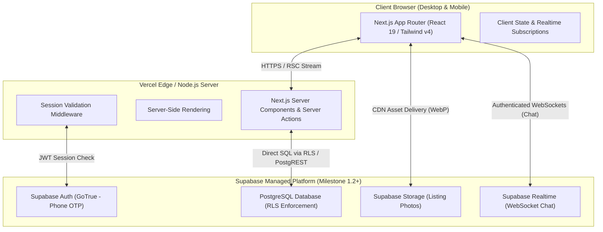
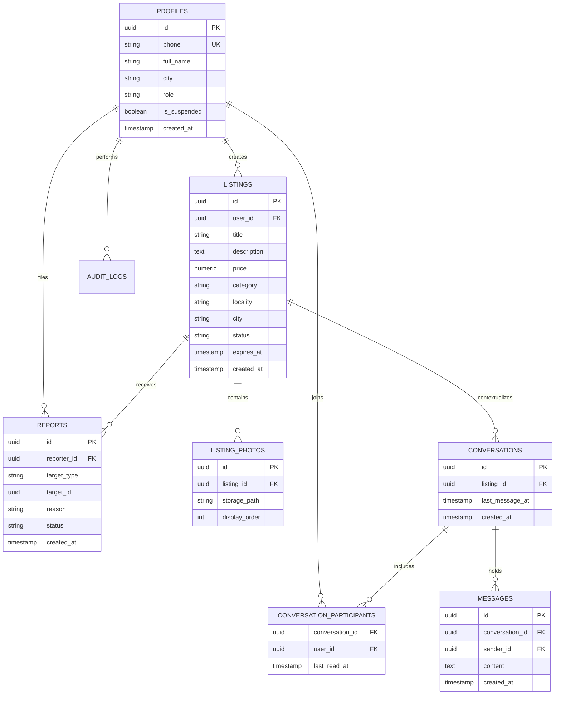
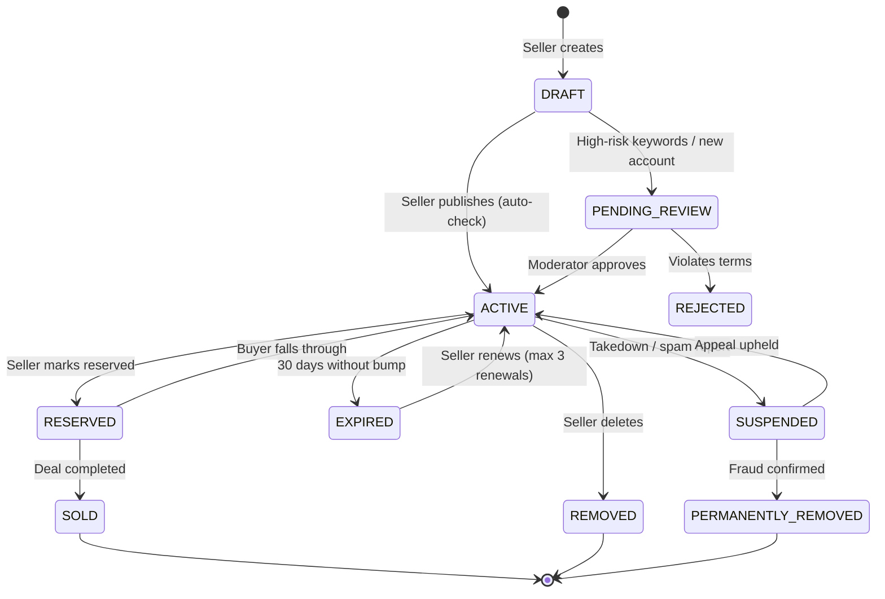

# FairSwap.in — Architecture and Foundation Design (Milestone 1.1)

Document version: 1.0 (2026-09-13)  
Milestone status: 1.1 Foundation (Build in Progress)

---

## 1. Product Boundary, Launch Assumptions, and Anti-Goals

### 1.1 Product Boundary
FairSwap.in is a hyperlocal peer-to-peer classifieds platform built specifically for Indian cities, enabling buyers and sellers to discover, negotiate, and arrange in-person exchanges within their immediate community.

- **What FairSwap IS**:
  - A local discovery and communication directory for physical, second-hand, or local goods.
  - A platform prioritizing localized city/locality browsing (starting with pilot cities).
  - A lightweight, privacy-preserving messaging channel for buyer-seller coordination.
  - An accountable community with identity verification signals (phone-verified accounts, community moderation).

- **What FairSwap IS NOT (Anti-Goals)**:
  - **No escrow, payment gateway, or in-app money transfers**: Buyers and sellers inspect goods in person and transact using cash or direct UPI at the point of exchange. FairSwap never holds, touches, or routes buyer funds.
  - **No integrated delivery or courier logistics**: No shipping labels, package tracking, door-to-door delivery fleets, or reverse pickups. All exchanges are local and face-to-face.
  - **No programmatic / dropshipping e-commerce**: No bulk merchant inventory feeds, automated dropshipping integrations, or algorithmic affiliate stores.
  - **No digital goods or financial instruments**: No cryptocurrency, gift card exchanges, non-fungible tokens, digital downloads, or money-lending solicitations.
  - **No pan-India shipping marketplace**: Unlike conventional e-commerce, listings outside the user's vicinity or selected locality are intentionally deprioritized to preserve transaction safety.

### 1.2 Configurable Launch Assumptions
- **Initial Pilot City**: Jaipur (Rajasthan) is configured as the initial reference city for development and testing. The city hierarchy is strictly data-driven and configurable without code changes.
- **Currency & Formatting**: Indian Rupee (INR, `₹`) with Indian numbering format (Lakhs / Crores where applicable).
- **Phone Prefix**: Standard E.164 phone numbering with India (`+91`) default.
- **Language**: English primary UI for Milestone 1.x, structured to allow Hindi localization in subsequent phases.

### 1.3 Unresolved Business Decisions (External to Engineering)
The following operational decisions are explicitly deferred to business stakeholders and legal counsel:
- Final legal entity structure, GST registration, and terms of service legal clearance.
- Official designated Grievance Officer and IT Rules 2021 compliance reporting pipeline.
- Production SMS gateway vendor selection (e.g., MSG91, Twilio, Gupshup) and DLT template registrations.
- Production transactional email provider selection (e.g., Resend, Postmark).
- Production domain ownership (`fairswap.in`) and DNS routing infrastructure.

---

## 2. Planned Route Map & Milestone Assignments

| Route | Milestone | Access Control | Purpose |
|---|---|---|---|
| `/` | 1.1 (Current) | Public | Brand landing, how-it-works, category overview, foundation notice |
| `/_not-found` | 1.1 (Current) | Public | Intentional branded 404 handler |
| `/login` | 1.2 | Public (Unauthenticated) | Phone OTP login & signup entry point |
| `/auth/callback` | 1.2 | Public | Supabase OAuth / OTP exchange handler |
| `/auth/verify` | 1.2 | Public | OTP entry screen |
| `/profile` | 1.2 | Authenticated | User account overview and edit profile |
| `/profile/[id]` | 1.2 | Public | Public user profile & member join date |
| `/listings` | 1.3 | Public | Search and browse directory with city/category filters |
| `/listings/[id]` | 1.3 | Public | Detailed listing view, photos, seller info, safety tips |
| `/listings/new` | 1.3 | Authenticated | Multi-step listing creation flow |
| `/listings/[id]/edit` | 1.3 | Authenticated (Owner) | Edit existing active listing |
| `/messages` | 1.4 | Authenticated | Conversations inbox |
| `/messages/[conversationId]` | 1.4 | Authenticated (Participant) | Real-time chat thread with transaction tips |
| `/safety` | 1.5 | Public | In-person exchange guidelines & scam prevention checklist |
| `/report` | 1.5 | Authenticated | Report listing or user moderation workflow |
| `/admin` | 1.6 | Staff (Reviewer+) | Internal moderation dashboard and queue |
| `/admin/listings` | 1.6 | Staff (Reviewer+) | Listing review, takedown, and audit queue |
| `/admin/users` | 1.6 | Staff (Moderator+) | User suspension and grievance resolution |

---

## 3. Architecture and Data Flow

### 3.1 High-Level Architecture (Mermaid)

### 3.2 Request & Session Lifecycle (Milestone 1.2+)

1. **Anonymous Read**: Visitor requests `/` or `/listings`. Request hits Next.js Edge/Server. PostgreSQL queries run via PostgREST with the `anon` role. Row-Level Security (RLS) returns only approved, active listings.
2. **Authenticated Request**: User holds an HTTP-only session cookie (managed via `@supabase/ssr`). Next.js middleware refreshes tokens transparently. Database operations execute with the authenticated user's JWT UID (`auth.uid()`).
3. **P2P Communication**: When negotiating, messages write to `messages` table with RLS restricting read/insert strictly to members of `conversation_participants`.

---

## 4. Conceptual Entities and Relationships

> *Note: This conceptual model outlines domain structure. Executable SQL migrations are explicitly deferred to Milestone 1.2.*

---

## 5. Permissions Matrix

The platform enforces zero-trust access control at the database level using PostgreSQL Row-Level Security (RLS). Application UI conditionally renders based on these roles:

| Action / Resource | Anonymous | Regular User (Non-Owner) | Item Owner | Conversation Member | Suspended User | Staff Reviewer | Staff Admin |
|---|---|---|---|---|---|---|---|
| View active listings | ✅ Allowed | ✅ Allowed | ✅ Allowed | ✅ Allowed | ✅ Allowed | ✅ Allowed | ✅ Allowed |
| Create new listing | ❌ Denied | ✅ Allowed | ✅ Allowed | ✅ Allowed | ❌ Denied | ✅ Allowed | ✅ Allowed |
| Edit/delete listing | ❌ Denied | ❌ Denied | ✅ Allowed | ❌ Denied | ❌ Denied | ⚠️ Flag/Hide | ✅ Full Admin |
| View listing phone/chat | ❌ Login Req | ✅ Allowed | ✅ Allowed | ✅ Allowed | ❌ Denied | ✅ Allowed | ✅ Allowed |
| Send message in chat | ❌ Denied | ❌ Denied | ❌ (Unless Participant) | ✅ Allowed | ❌ Denied | ❌ Denied | ❌ Denied (Privacy) |
| Mark item reserved/sold | ❌ Denied | ❌ Denied | ✅ Allowed | ❌ Denied | ❌ Denied | ❌ Denied | ✅ Allowed |
| Flag / Report listing | ❌ Denied | ✅ Allowed | ❌ Denied | ✅ Allowed | ❌ Denied | N/A | N/A |
| View moderation queue | ❌ Denied | ❌ Denied | ❌ Denied | ❌ Denied | ❌ Denied | ✅ Allowed | ✅ Allowed |
| Ban/suspend user | ❌ Denied | ❌ Denied | ❌ Denied | ❌ Denied | ❌ Denied | ❌ Propose Only | ✅ Allowed |

---

## 6. Listing-State Transition Matrix

Listings follow a strict state machine to prevent ghost listings, fraudulent updates, or zombie conversations:

### Transition Invariants (Milestone 1.3 Durable Architecture):
1. **Strict Material-Edit Re-Review Policy**: Any seller modification to material listing fields (`title`, `description`, `category_id`, `condition`, `price_type`, `price_paise`, `cover_photo_id`, or photographs via add/delete/reorder) on an approved listing while in `active`, `reserved`, or `paused` states automatically transitions the listing to `pending_review` and increments `revision`. A paused listing that has been materially edited cannot be resumed directly to `active`.
2. **Rejected-to-Draft Edit Transition**: An allowed edit to a `rejected` listing automatically transitions it back to `draft`, increments `revision`, clears `rejection_reason` from the listing row, and preserves the historical rejection reason in `listing_status_transitions`.
3. **Private, Server-Mediated Storage Pipeline**: Supabase Storage buckets (`listing-originals`, `listing-derivatives`) are strictly private with no anonymous or authenticated RLS access policies. All uploads, deletions, and derivative deliveries are server-mediated. Direct database table `DELETE` on `listing_media` is revoked from `authenticated`; media deletion is mediated by `DELETE /api/listings/[id]/media/[mediaId]`, which removes Storage objects before triggering internal database deletion.
4. **Renewal Bound**: Listings have a central pilot maximum of 3 renewals from `expired` back to `active`.
5. **Account Suspension**: If a seller's profile is suspended, active listings are suppressed from search and visibility.
6. **Automatic Expiry**: Active listings expire automatically after 30 days (`expires_at`), verifiable via idempotent scheduled task.

---

## 7. Threat Checklist & Defensive Measures

| Threat Vector | Severity | Mitigation Strategy | Milestone |
|---|---|---|---|
| **Account Takeover (OTP Brute Force)** | CRITICAL | Rate limit OTP generation and verification to 5 attempts per 15 minutes per IP/phone. Lock phone on consecutive failures. | 1.2 |
| **Cross-Account Insecure Direct Object References (IDOR)** | CRITICAL | PostgreSQL Row-Level Security (RLS) policies binding `auth.uid() = user_id` for all write/update operations. | 1.2, 1.3 |
| **Direct API Bypass** | HIGH | Supabase Service Role Key is strictly isolated to server-side trusted actions and never bundled in client code. Client uses publishable anon key only. | 1.2 |
| **Chat Snooping / Cross-Conversation Eavesdropping** | HIGH | RLS join policy on `conversation_participants`. Messages cannot be read or inserted unless requester is a verified participant. | 1.4 |
| **Malicious File Upload (Web Shells, EXIF Tracking)** | HIGH | Supabase Storage MIME type validation (JPEG/PNG/WebP only), 5MB file cap, server-side EXIF stripping to remove GPS coordinates before storage. | 1.3 |
| **Phishing / External Payment Scam in Chat** | HIGH | Automated heuristic detection for phone numbers, external payment links (`paytm.me`, unknown domains) with in-chat warning banners. | 1.4, 1.5 |
| **Staff Privilege Abuse / Rogue Employee** | HIGH | Role separation (`reviewer` vs `admin`). All admin actions logged to immutable `audit_logs` table with timestamp and IP address. | 1.6 |
| **Denial of Service / Listing Scraping** | MEDIUM | Next.js Edge rate-limiting on search and listing endpoints. Robots.txt preventing unauthorized AI crawlers. | 1.3, 1.5 |
| **Search Engine Indexing of Scaffold / Staging** | MEDIUM | `robots: { index: false, follow: false }` metadata tag enforced across all pre-production foundations. | 1.1 (Enforced) |

---

## 8. Design System, Responsive Tokens, and Accessibility

### 8.1 Design Tokens (Tailwind CSS v4 `@theme`)
- **Brand Colors**: Restrained forest green/emerald primary (`#059669` / `var(--color-brand-600)`) conveying trust and calm commerce, paired with slate neutral scales (`#0f172a` text, `#f8fafc` light surface, `#1e293b` dark surface).
- **Typography**: System font stack (`system-ui, -apple-system, BlinkMacSystemFont, 'Segoe UI', Roboto, sans-serif`) to ensure zero network latency, instant rendering, and optimal readability across Indian mobile networks.
- **Elevation & Borders**: Subtle 1px borders (`border-neutral-200` / `border-neutral-700`) replacing heavy drop shadows for clean, modern interfaces.

### 8.2 Responsive Layout
- **Mobile First**: Minimum target viewport 360px width.
- **Breakpoints**: Standard responsive thresholds (`sm: 640px`, `md: 768px`, `lg: 1024px`, `xl: 1280px`).
- **Touch Targets**: Minimum interactive dimensions of 44x44px for touch accessibility on mobile devices.

### 8.3 Accessibility & Semantic Standards
- **Landmarks**: Distinct `<header>`, `<main>`, `<nav>`, `<footer>`, and `<aside>` elements.
- **Announcements**: `role="status"` and `aria-live="polite"` on dynamic notices and development banners.
- **Focus Management**: Explicit accessible focus rings (`focus-visible:ring-2 focus-visible:ring-brand-500 focus-visible:outline-hidden`).
- **Reduced Motion**: Respects user OS `prefers-reduced-motion` settings for all transitions.

---

## 9. Deferred Controls Matrix (NOT IMPLEMENTED)

To prevent premature abstraction, scope creep, or phantom code, the following items are deliberately omitted from Milestone 1.1:

| Component / Subsystem | Milestone Deferred | Status in 1.1 |
|---|---|---|
| Supabase client (`@supabase/ssr`) | 1.2 | **NOT IMPLEMENTED** (No packages installed) |
| Supabase SQL migrations & RLS | 1.2 | **NOT IMPLEMENTED** (Conceptual schema only) |
| Phone OTP Authentication flow | 1.2 | **NOT IMPLEMENTED** (Login routes omitted) |
| Listing creation & photo upload | 1.3 | **NOT IMPLEMENTED** (Static preview categories only) |
| Full-text search & city filtering | 1.3 | **NOT IMPLEMENTED** (No search backend) |
| Realtime buyer-seller messaging | 1.4 | **NOT IMPLEMENTED** (No chat websockets) |
| Report listing & user safety center | 1.5 | **NOT IMPLEMENTED** (Static guidelines in docs) |
| Admin moderation dashboard | 1.6 | **NOT IMPLEMENTED** (No admin routes) |
| Docker containerization & hosting | Post-1.6 | **NOT IMPLEMENTED** (Local execution only) |
