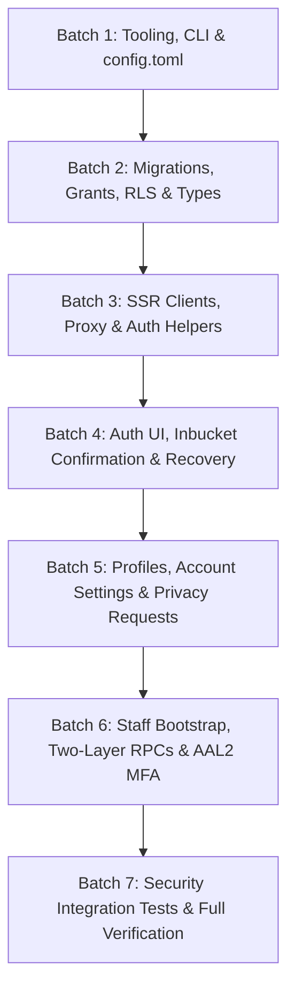

# Milestone 1.2 — Accounts and Secure Supabase Foundation Implementation Plan

Revision: **r5** | Status: **PROPOSED** | Date: 2026-09-13  
Target Milestone: Milestone 1.2 (`docs/milestones/1.2-accounts-security.md`)

---

## 1. Revision History & r4-to-r5 Change Summary

| Revision | Status | Date | Key Changes & Review Notes |
|---|---|---|---|
| **r1** | SUPERSEDED | 2026-09-13 | Initial proposal. Captured high-level architecture, SSR patterns, and local Docker prerequisite observation (`DOCKER_NOT_FOUND`). |
| **r2** | SUPERSEDED | 2026-09-13 | Addressed initial review corrections: MFA/AAL2 session enforcement, trusted provisioning trigger, field permission matrix, privacy bounds, `app_security` internal schema, and SSR `src/proxy.ts`. |
| **r3** | SUPERSEDED | 2026-09-13 | Focused correction pass: exact CLI `2.117.0`, `config.toml` keys, permission matrix, 15 named tests, Docker diagnostics, and verification tiers. |
| **r4** | SUPERSEDED | 2026-09-13 | Addressed review corrections: unexposed `app_security`, callable RPC wrappers, loopback bridge network, revalidated SSR dependencies, advisory-locked privacy limits. |
| **r5** | **PROPOSED** | 2026-09-13 | Final consistency pass addressing user review:<br>1. **Private Schema Privileges for RLS Helpers**: Granted `USAGE ON SCHEMA app_security TO anon, authenticated, service_role` so RLS policies can invoke helper functions. Granted `EXECUTE` individually on `get_account_status` (to `anon, authenticated, service_role`) and staff/AAL helpers (to `authenticated`). Revoked default function EXECUTE via `ALTER DEFAULT PRIVILEGES`. Private audit writer remains non-executable directly by `anon/authenticated`. Added tests proving legitimate RLS reads succeed alongside denial tests.<br>2. **Two-Layer RPC Architecture (No Security Definer in Public)**: Defined exposed `public.*` RPC wrappers as `SECURITY INVOKER`. Privileged implementation functions (`app_security.impl_*`) reside in unexposed `app_security` as `SECURITY DEFINER` with `SET search_path = ''`. Private implementations independently enforce authenticated caller, active permitted staff role, and AAL2. Specifically documented role rules: account status change (`administrator`), staff role assignment/revocation (`administrator`), privacy request resolution (`administrator` OR `support_agent` + active + AAL2). Privileged mutation and audit write remain atomic.<br>3. **Explicit Data API Grants in Every Migration**: Encoded explicit PostgreSQL column and table grants alongside RLS for every table (`profiles`, `user_accounts`, `staff_roles`, `audit_logs`, `privacy_requests`). Specified minimum explicit grants for `service_role` (local bootstrap & test cleanup). Added tests proving missing grants deny before RLS, and granted operations pass to RLS evaluation.<br>4. **Exact Service Inventory & Inbucket Networking**: Updated `config.toml` to explicitly include `[edge_runtime] enabled = false`, alongside disabled `studio`, `realtime`, `storage`, and `analytics`. Clarified that Inbucket Web UI (54324), SMTP (54325), and POP3 (54326) are host-published and included in the loopback verification boundary. Made Docker bridge network creation idempotent (inspects existing network options and fails safely if incompatible). |

---

## 2. Goal & Product Boundary

Establish a real, locally integrated Supabase account and security foundation built on top of the accepted Milestone 1.1 Next.js application at the FairSwap root (`fairswap`).

### In Scope for Milestone 1.2
- **Local Supabase Environment**: CLI configuration (`config.toml`), migrations, seeds, local mail catcher (Inbucket), dedicated idempotent loopback bridge network (`fairswap-local-net`), and strict loopback port isolation (`127.0.0.1`).
- **Database Schema & RLS**: Strict Row-Level Security and explicit PostgreSQL GRANTs for accounts, public profiles, staff roles, audit logs, and privacy requests.
- **Trusted Database Trigger Provisioning**: Exact-once account/profile provisioning from `auth.users` insert; clients cannot insert or upsert trusted account records.
- **TypeScript Type Generation**: Pinned, UTF-8 checked type generation (`src/types/database.ts`) directly from applied local schema.
- **Next.js 16 SSR Integration**: Request-scoped clients via `@supabase/ssr`, `src/proxy.ts` token/claims validation via `getClaims()`, fresh server confirmation via `getUser()`, and `Cache-Control: private, no-store, must-revalidate` response headers on cookie mutations.
- **Customer Authentication & Recovery**: Email/password registration, local mail confirmation via Inbucket, login, logout, password recovery, and secure redirect validation.
- **Public vs. Private Separation**: Public profile (`public.profiles`) readable by all for active users; private account details (`public.user_accounts`) accessible solely by the row owner.
- **Trusted Account Status Lifecycle**: `active`, `suspended`, `deletion_pending`, `deleted`. Suspended accounts immediately lose prohibited capabilities with existing sessions.
- **Staff Roles & MFA Assurance (AAL2)**: Roles (`administrator`, `moderator`, `support_agent`, `content_editor`). Privileged reads and writes require permitted role + active status + JWT `aal2`. Self-role visibility preserved at AAL1 to enable MFA challenge without enrollment lockout.
- **Two-Layer RPC Architecture**: Exposed `public.*` entry points are `SECURITY INVOKER`, delegating to unexposed `app_security.impl_*` `SECURITY DEFINER` functions with role + AAL2 verification and atomic audit logging.
- **Secure Administrator Bootstrap**: Separate, target-specific, idempotent local CLI script (`scripts/bootstrap-admin.ts`) using service-role key; never first-signup-wins.
- **Privacy Request Tracking & Concurrency-Safe Rate Limiting**: User-owned data/deletion request submission and status records (`public.privacy_requests`) with duplicate pending constraint and advisory-locked rolling limit (max 3 per 30 days); explicit distinction from Milestone 1.5 fulfillment.
- **Direct-API Security & Browser Testing**: Direct PostgREST/Auth integration tests asserting RLS boundaries; Playwright multi-viewport browser journeys.
- **Preservation of Milestone 1.1**: Public foundation pages and 1.1 regression tests remain functional with no Supabase services running.

### Explicitly Excluded (Deferred to Milestones 1.3–1.6)
- Marketplace listings, categories, attributes, and posting forms (Milestone 1.3).
- Media storage, image upload pipeline, and CDN delivery (Milestone 1.3).
- Search, discovery, location filters, and indexing (Milestone 1.4).
- Buyer-seller messaging and Realtime chat (Milestone 1.5).
- Operational moderation cases, reports triage, and user appeals (Milestone 1.5 / 1.6).
- Automated data export or account deletion fulfillment jobs (Milestone 1.5).
- Paid features, billing, escrow, or external payment gateways (Out of scope for Phase 1).
- Phone OTP / SMS gateway setup (deferred in Milestone 1.2; subsequently evaluated and intentionally abandoned under Issue #12 / PR #60; not implemented).
- Hosted Supabase project connection, production deployment, or cloud infrastructure.
- Broader application logging/monitoring infrastructure (deferred to post-1.2 review).

---

## 3. Environment & Local Networking Enforcement

### 3.1. Diagnostic Findings & Prerequisite Boundary

Through approved read-only checks, the host environment was diagnosed:
- **OS**: Windows 11 x64 (NT 10.0.26200.0), PowerShell 5.1.
- **Node & pnpm**: Node `v24.15.0`, Corepack pnpm `10.12.1` (all commands run via `corepack pnpm <cmd>`).
- **Git**: `2.45.1.windows.1`, branch `Phase1`, baseline commit `e3a536c`.
- **Supabase CLI**: Pinned exactly to version `2.117.0` in `package.json` (`devDependencies: { "supabase": "2.117.0" }`).
- **Docker Engine**: **NOT INSTALLED** (`DOCKER_NOT_FOUND`).
  - Diagnostic confirmed: No `docker` on PATH, no Docker Windows service registered, neither `C:\Program Files\Docker\Docker` nor `C:\ProgramData\Docker` exists, and WSL is not installed (`wsl -l -v` reports WSL not installed).
  - **Prerequisite Boundary**: Installing Docker Desktop or enabling WSL requires administrative elevation outside Antigravity. Antigravity will not install tools, change WSL configuration, or elevate privileges. This is an external prerequisite requiring the user's manual setup before Phase B container execution.

### 3.2. Idempotent Loopback Network & Service Inventory

1. **Idempotent Bridge Network Creation**:
   - Before starting containers, create or verify the dedicated bridge network with `host_binding_ipv4=127.0.0.1`:
     ```powershell
     # Check if network already exists and verify its configuration
     $netExists = docker network ls -q -f name=^fairswap-local-net$
     if ($netExists) {
         $binding = docker network inspect fairswap-local-net --format '{{index .Options "com.docker.network.bridge.host_binding_ipv4"}}'
         if ($binding -ne "127.0.0.1") {
             Write-Error "Incompatible fairswap-local-net exists with binding: $binding. Expected 127.0.0.1"
             exit 1
         }
     } else {
         docker network create --driver bridge --opt "com.docker.network.bridge.host_binding_ipv4=127.0.0.1" fairswap-local-net
     }
     ```
   - Supabase is launched using this network via:
     ```bash
     corepack pnpm exec supabase start --network-id fairswap-local-net
     ```

2. **Accurate Local Service Inventory**:
   - **Enabled Services**:
     - API Gateway (PostgREST, GoTrue Auth): port `54321`
     - PostgreSQL Database: port `54322`
     - Inbucket Web UI: port `54324`
     - Inbucket SMTP: port `54325` (host-published by CLI for local GoTrue mail delivery; verified on loopback)
     - Inbucket POP3: port `54326` (host-published by CLI; verified on loopback)
   - **Explicitly Disabled Services**:
     - `[studio] enabled = false`
     - `[realtime] enabled = false`
     - `[storage] enabled = false`
     - `[analytics] enabled = false`
     - `[edge_runtime] enabled = false`
     - `[vector] enabled = false`

3. **Comprehensive Port Verification**:
   - Immediately following startup, inspect ALL host-published Docker port mappings and active TCP listeners:
     ```powershell
     Get-NetTCPConnection -State Listen | Where-Object { $_.LocalPort -in 54321, 54322, 54324, 54325, 54326 } | Select-Object LocalAddress, LocalPort, State
     ```
     ```bash
     docker ps --format "{{.Names}}: {{.Ports}}"
     ```
   - **Verification Pass Criteria**:
     - Every published mapping in `docker ps` MUST display `127.0.0.1:<port>->...` or `[::1]:<port>->...`.
     - Every listener in `Get-NetTCPConnection` MUST have `LocalAddress` equal to `127.0.0.1` or `::1`.
     - Any listener bound to `0.0.0.0`, `::`, or a non-loopback adapter constitutes a security failure and aborts verification.

---

## 4. Configuration & Dependencies Specification

### 4.1. `supabase/config.toml` (CLI 2.117.0 Keys)

```toml
# supabase/config.toml - Milestone 1.2 Local Configuration
project_id = "fairswap-local"

[api]
enabled = true
port = 54321
schemas = ["public"]
extra_search_path = ["public", "extensions"]
max_rows = 1000

[db]
port = 54322
shadow_port = 54320
major_version = 15

[db.pooler]
enabled = false

[studio]
enabled = false

[realtime]
enabled = false

[storage]
enabled = false

[analytics]
enabled = false

[edge_runtime]
enabled = false

[auth]
enabled = true
site_url = "http://localhost:3000"
additional_redirect_urls = [
  "http://127.0.0.1:3000/auth/callback",
  "http://localhost:3000/auth/callback",
  "http://127.0.0.1:3001/auth/callback"
]
jwt_expiry = 3600
enable_signup = true

[auth.email]
enable_signup = true
enable_confirmations = true
double_confirm_changes = true

[auth.email.template.confirmation]
subject = "Confirm your FairSwap Account"
content_path = "./supabase/templates/confirm_email.html"

[auth.email.template.recovery]
subject = "Reset your FairSwap Password"
content_path = "./supabase/templates/recovery_email.html"

[auth.mfa.totp]
enroll_enabled = true
verify_enabled = true

[inbucket]
enabled = true
port = 54324
smtp_port = 54325
pop3_port = 54326
```

### 4.2. Revalidated Dependencies & Installation Commands

Revalidated against current npm registry:
- **Runtime Dependencies**:
  - `@supabase/ssr: "^0.12.7"` (current compatible release)
  - `@supabase/supabase-js: "^2.116.0"`
  - `zod: "^3.24.2"`
  - `react-hook-form: "^7.88.0"`
- **Dev Dependencies**:
  - `"supabase": "2.117.0"` (pinned exact CLI)
  - `"tsx": "^4.19.3"`

Installation commands:
```bash
corepack pnpm add @supabase/ssr@^0.12.7 @supabase/supabase-js@^2.116.0 zod@^3.24.2 react-hook-form@^7.88.0
corepack pnpm add -D supabase@2.117.0 tsx@^4.19.3
```

---

## 5. Security & Permission Architecture

### 5.1. Private Schema Privileges for RLS Helpers

To allow RLS policies to invoke helper functions while keeping `app_security` strictly unexposed to PostgREST:
1. **Schema Privilege Boundaries**:
   ```sql
   CREATE SCHEMA IF NOT EXISTS app_security;
   REVOKE ALL ON SCHEMA app_security FROM PUBLIC, authenticated, anon;
   -- Grant minimum USAGE so RLS callers can execute authorized helper functions
   GRANT USAGE ON SCHEMA app_security TO anon, authenticated, service_role;
   -- Prevent accidental exposure of newly created functions
   ALTER DEFAULT PRIVILEGES IN SCHEMA app_security REVOKE EXECUTE ON FUNCTIONS FROM PUBLIC, authenticated, anon;
   ```
2. **Individual Helper EXECUTE Grants**:
   - `app_security.get_account_status(uuid)`:
     ```sql
     GRANT EXECUTE ON FUNCTION app_security.get_account_status(uuid) TO anon, authenticated, service_role;
     ```
     (Executable by `anon` and `authenticated` because public-profile RLS policies invoke it to verify account status is `'active'`).
   - `app_security.get_my_staff_role()`:
     ```sql
     GRANT EXECUTE ON FUNCTION app_security.get_my_staff_role() TO authenticated, service_role;
     ```
     (Executable by `authenticated` for self-role check at AAL1 without lockout).
   - `app_security.is_active_staff_aal2(staff_role_enum)`:
     ```sql
     GRANT EXECUTE ON FUNCTION app_security.is_active_staff_aal2(staff_role_enum) TO authenticated, service_role;
     ```
     (Executable by `authenticated` for staff RLS policies).
   - `app_security.log_audit_event(...)`:
     ```sql
     REVOKE ALL ON FUNCTION app_security.log_audit_event FROM PUBLIC, authenticated, anon;
     ```
     (Zero direct execute grant to `anon` or `authenticated`; only invoked internally by private implementation functions running as `postgres`).

---

### 5.2. Two-Layer RPC Architecture (No Security Definer in Public)

Privileged administrative actions execute through a strict two-layer design:

```
[HTTP Request via PostgREST]
       │
       ▼
[Exposed public.* RPC Wrapper] (SECURITY INVOKER, search_path = '')
  - Checks: auth.uid() IS NOT NULL
  - Delegates to: app_security.impl_*
       │
       ▼
[Unexposed app_security.impl_* Implementation] (SECURITY DEFINER, search_path = '')
  - Enforces: Caller active status + Permitted Role + AAL2
  - Mutates target table
  - Calls: app_security.log_audit_event(...)
  - Atomically commits mutation + audit record in single transaction
```

#### Documented Role Rules:
1. **Account Status Change (`app_security.impl_update_user_account_status`)**:
   - Permitted Role: `administrator` only.
   - Requires: caller status `'active'` + JWT claim `aal = 'aal2'`.
2. **Staff Role Assignment / Revocation (`app_security.impl_assign_staff_role`, `app_security.impl_revoke_staff_role`)**:
   - Permitted Role: `administrator` only.
   - Requires: caller status `'active'` + JWT claim `aal = 'aal2'`.
3. **Privacy Request Resolution (`app_security.impl_resolve_privacy_request`)**:
   - Permitted Roles: `administrator` OR `support_agent`. (Specifically permits `support_agent` per the milestone contract).
   - Requires: caller status `'active'` + JWT claim `aal = 'aal2'`.

#### Implementation & Grants:
```sql
-- Private Implementation (unexposed schema)
CREATE OR REPLACE FUNCTION app_security.impl_update_user_account_status(
  p_target_user_id uuid,
  p_new_status public.account_status_enum,
  p_reason text
) RETURNS void
LANGUAGE plpgsql VOLATILE SECURITY DEFINER
SET search_path = ''
AS $$
BEGIN
  IF auth.uid() IS NULL THEN
    RAISE EXCEPTION 'Not authenticated';
  END IF;

  IF NOT app_security.is_active_staff_aal2('administrator') THEN
    RAISE EXCEPTION 'Forbidden: requires active administrator with AAL2';
  END IF;

  UPDATE public.user_accounts
  SET account_status = p_new_status, updated_at = pg_catalog.clock_timestamp()
  WHERE user_id = p_target_user_id;

  INSERT INTO public.audit_logs (actor_id, action, target_entity, target_id, details, created_at)
  VALUES (
    auth.uid(),
    'user_account.status_update',
    'user_accounts',
    p_target_user_id,
    jsonb_build_object('new_status', p_new_status, 'reason', p_reason),
    pg_catalog.clock_timestamp()
  );
END;
$$;

GRANT EXECUTE ON FUNCTION app_security.impl_update_user_account_status TO authenticated, service_role;

-- Public RPC Wrapper (exposed schema, SECURITY INVOKER)
CREATE OR REPLACE FUNCTION public.admin_update_user_account_status(
  p_target_user_id uuid,
  p_new_status public.account_status_enum,
  p_reason text
) RETURNS void
LANGUAGE plpgsql VOLATILE SECURITY INVOKER
SET search_path = ''
AS $$
BEGIN
  PERFORM app_security.impl_update_user_account_status(p_target_user_id, p_new_status, p_reason);
END;
$$;

REVOKE EXECUTE ON FUNCTION public.admin_update_user_account_status FROM PUBLIC, anon;
GRANT EXECUTE ON FUNCTION public.admin_update_user_account_status TO authenticated;
```

---

### 5.3. Explicit Data API Grants Matrix

In every migration, explicit PostgreSQL grants are defined alongside RLS:

| Table / Routine | Operation | `anon` | `authenticated` | `service_role` (Bootstrap & Cleanup) | Notes |
|---|---|---|---|---|---|
| **`public.profiles`** | `SELECT` | **GRANT** | **GRANT** | **GRANT** | Filtered by RLS (third parties see only active profiles). |
| | `UPDATE` | REVOKED | **GRANT (display_name, avatar_url, bio, city, state)** | **GRANT** | Column-level grant for user-editable fields only. |
| | `INSERT` | REVOKED | REVOKED | **GRANT** | Client insert revoked; handled by Auth trigger. |
| | `DELETE` | REVOKED | REVOKED | **GRANT** | Client delete revoked; cascade or cleanup only. |
| **`public.user_accounts`**| `SELECT` | REVOKED | **GRANT** | **GRANT** | Filtered by RLS (owner or admin/support AAL2). |
| | `UPDATE` | REVOKED | **GRANT (notification_preferences, optional_contact_preferences)** | **GRANT** | Column-level grant; trusted fields immutable. |
| | `INSERT` | REVOKED | REVOKED | **GRANT** | Handled exclusively by Auth trigger. |
| | `DELETE` | REVOKED | REVOKED | **GRANT** | Cleanup only. |
| **`public.staff_roles`** | `SELECT` | REVOKED | **GRANT** | **GRANT** | Filtered by RLS (self or admin AAL2). |
| | `INSERT` | REVOKED | REVOKED | **GRANT** | Managed via bootstrap script or RPC. |
| | `UPDATE` | REVOKED | REVOKED | **GRANT** | Managed via RPC. |
| | `DELETE` | REVOKED | REVOKED | **GRANT** | Managed via RPC. |
| **`public.audit_logs`** | `SELECT` | REVOKED | **GRANT** | **GRANT** | Filtered by RLS (admin + AAL2 only). |
| | `INSERT` | REVOKED | REVOKED | **GRANT** | Client insert revoked; written via private helper. |
| | `UPDATE` | REVOKED | REVOKED | REVOKED | Append-only integrity (revoked from all). |
| | `DELETE` | REVOKED | REVOKED | REVOKED | Append-only integrity (revoked from all). |
| **`public.privacy_requests`**| `SELECT` | REVOKED | **GRANT** | **GRANT** | Filtered by RLS (owner or admin/support AAL2). |
| | `INSERT` | REVOKED | **GRANT** | **GRANT** | Permitted types only; rate-limited by trigger. |
| | `UPDATE` | REVOKED | REVOKED | **GRANT** | Client update revoked; resolved via RPC. |
| | `DELETE` | REVOKED | REVOKED | **GRANT** | Client delete revoked. |
| **`public.admin_*` RPCs** | `EXECUTE`| REVOKED | **GRANT** | **GRANT** | Enforces active role + AAL2 inside implementation. |

---

### 5.4. Concurrency-Safe Privacy Request Rate Limiting

1. **Transaction-Scoped Advisory Locking**:
   - The `BEFORE INSERT` trigger on `public.privacy_requests` (`enforce_privacy_request_limits`) acquires an advisory transaction lock on the submitting user:
     ```sql
     -- Acquire transaction-scoped lock serializing concurrent inserts for this user
     PERFORM pg_advisory_xact_lock(hashtext('privacy_request_' || NEW.user_id::text));

     -- Serialized check: count existing requests in rolling 30-day window
     IF (
       SELECT count(*) 
       FROM public.privacy_requests 
       WHERE user_id = NEW.user_id 
         AND requested_at > pg_catalog.clock_timestamp() - interval '30 days'
     ) >= 3 THEN
       RAISE EXCEPTION 'Rate limit exceeded: maximum 3 privacy requests per 30 days';
     END IF;
     ```
   - Transaction lock is released on commit/rollback. Overlapping submissions serialize, ensuring the rolling 30-day count is evaluated against committed state.
2. **Duplicate Pending Request Constraint**:
   - Partial unique index `idx_unique_pending_privacy_request` on `(user_id, request_type) WHERE status = 'pending'` prevents concurrent duplicate pending requests.

---

### 5.5. Current Next.js 16 SSR & Auth Configuration

1. **Proxy Session Handling (`src/proxy.ts`)**:
   - Follows current Supabase SSR guidance:
     - Uses `supabase.auth.getClaims()` to validate session token and refresh cookies for request routing.
     - `getUser()` is reserved for flows where a fresh server-confirmed user record is required from the Auth server (e.g. at login or profile load).
     - `getSession()` is **never** used as a trusted authorization source.
   - For all responses where cookies are refreshed or set:
     - Sets header `Cache-Control: private, no-store, must-revalidate` to prevent shared CDN or browser cache retention of authenticated responses.
   - Route guards:
     - Private paths (`/account/*`): redirects unauthenticated users to `/auth/sign-in?next=...`.
     - Staff paths (`/admin/*`): verifies staff role; redirects to `/auth/mfa` if session is at AAL1; redirects to `/` if not staff.
     - Suspended accounts: redirects suspended users to `/account/security` with an account suspension notice.

---

## 6. Implementation Batches



### Batch 1: Local Tooling & Configuration
- Pin `supabase: "2.117.0"` and `tsx` in `devDependencies`.
- Add runtime dependencies: `@supabase/ssr@^0.12.7`, `@supabase/supabase-js@^2.116.0`, `zod@^3.24.2`, `react-hook-form@^7.88.0`.
- Configure `supabase/config.toml` (disabled unnecessary services, strict loopback bindings, exact keys, Inbucket templates, TOTP MFA).
- Create `.env.example` documenting `NEXT_PUBLIC_SITE_URL`, `NEXT_PUBLIC_SUPABASE_URL`, `NEXT_PUBLIC_SUPABASE_PUBLISHABLE_KEY`.
- Add local email templates in `supabase/templates/`.

### Batch 2: Migrations, Grants, RLS & Generated Types
- Migration 1: `20260914000001_create_accounts_and_profiles.sql` (enums, `profiles`, `user_accounts`, `app_security` schema, `handle_new_user()` trigger, RLS policies, column grants).
- Migration 2: `20260914000002_create_staff_and_security.sql` (`staff_roles`, `app_security.is_active_staff_aal2()`, staff RLS policies, grants).
- Migration 3: `20260914000003_create_audit_and_privacy.sql` (`audit_logs`, `privacy_requests`, advisory-locked rate limit trigger, `app_security.impl_*` functions, public `SECURITY INVOKER` RPC wrappers).
- Generate TypeScript types to `src/types/database.ts` via Windows-compatible UTF-8 command with exit code validation.

### Batch 3: Next.js 16 SSR Clients & Session Proxy
- Implement request-scoped client factories in `src/lib/supabase/`: `client.ts`, `server.ts`.
- Implement `src/proxy.ts` using `getClaims()` for session validation, cookie sync, route guards, suspension routing, and `Cache-Control: private, no-store, must-revalidate`.
- Implement `/auth/callback/route.ts` with open-redirect validation and safe error states.

### Batch 4: Customer Authentication & Recovery UI
- Sign-up (`/auth/sign-up`) with explicit terms versioning (`terms_version: "2026-09-13-draft"`).
- Sign-in (`/auth/sign-in`) with error handling.
- Confirmation landing page (`/auth/confirm`).
- Forgot-password (`/auth/forgot-password`) and reset-password (`/auth/reset-password`).
- Server actions for auth operations using `getUser()` for server-confirmed verification.

### Batch 5: Profiles, Account Settings & Privacy Requests
- Public profile page (`/seller/[id]` / `/profile/[id]`): displays public fields only for active users.
- Private account dashboard (`/account`), profile editor (`/account/profile`), security settings (`/account/security`), and privacy request submission (`/account/privacy`).
- Server actions for profile update (permitted fields only) and privacy request submission.
- Suspended account notice and restricted navigation for suspended users.

### Batch 6: Staff Roles, AAL2 MFA, RPCs & Admin Bootstrap
- Implement `scripts/bootstrap-admin.ts` using service-role key for explicit admin promotion.
- Staff MFA enrollment and challenge UI (`/auth/mfa`).
- Staff management portal skeleton (`/admin`, `/admin/staff`, `/admin/audit`) enforcing role + active status + AAL2 via two-layer RPCs.
- Verify atomic audit logging on role changes and account status modifications.

### Batch 7: Security Tests, Regression & Verification
- Direct-API RLS integration tests (`tests/security/rls.test.ts`) covering all named positive, negative, and concurrency tests.
- Playwright browser journeys (`e2e/auth.spec.ts`) testing registration, Inbucket confirmation, recovery, and MFA.
- Milestone 1.1 regression verification (`corepack pnpm run test:foundation`).
- Sanitize and archive test evidence to `artifacts/verification/1.2/`.

---

## 7. Verification & Acceptance-to-Test Matrix

### 7.1. Acceptance-to-Test Mapping

| Requirement / Invariant | Verification Method | Specific Test File & Test Identifier |
|---|---|---|
| **Confirmed Registration & Denied Unconfirmed Access** | Playwright E2E | `e2e/auth.spec.ts` -> `test_unconfirmed_login_denied` |
| **Confirmation / Recovery Failures & Success** | Playwright E2E | `e2e/auth.spec.ts` -> `test_recovery_flow_via_inbucket` |
| **PostgreSQL Privilege Denial Before RLS** | Direct-API RLS | `tests/security/rls.test.ts` -> `test_privilege_denial_before_rls` |
| **Legitimate RLS Reads Succeed for Permitted Roles** | Direct-API RLS | `tests/security/rls.test.ts` -> `test_legitimate_rls_reads_succeed` |
| **Cross-User Account Read Denied** | Direct-API RLS | `tests/security/rls.test.ts` -> `test_cross_user_account_read_denied` |
| **Cross-User Account Update Denied** | Direct-API RLS | `tests/security/rls.test.ts` -> `test_cross_user_account_update_denied` |
| **Protected Account Status Tamper Denied** | Direct-API RLS | `tests/security/rls.test.ts` -> `test_protected_status_tamper_denied` |
| **Protected Terms Tamper Denied** | Direct-API RLS | `tests/security/rls.test.ts` -> `test_protected_terms_tamper_denied` |
| **Self-Granted Role Escalation Denied** | Direct-API RLS | `tests/security/rls.test.ts` -> `test_self_role_escalation_denied` |
| **Direct Audit INSERT Forgery Denied** | Direct-API RLS | `tests/security/rls.test.ts` -> `test_audit_log_insert_forgery_denied` |
| **Direct Private Audit Helper Execution Denied** | Direct-API RLS | `tests/security/rls.test.ts` -> `test_private_audit_helper_execution_denied` |
| **Unauthorized / AAL1 RPC Call Denied** | Direct-API RLS | `tests/security/rls.test.ts` -> `test_rpc_aal1_denied` |
| **Authorized AAL2 RPC Creates Atomic Audit Entry** | Direct-API RLS | `tests/security/rls.test.ts` -> `test_rpc_aal2_atomic_audit_success` |
| **Staff AAL1 Privileged Read Denied** | Direct-API RLS | `tests/security/rls.test.ts` -> `test_staff_aal1_privileged_read_denied` |
| **Suspension Takes Effect on Existing Token** | Direct-API RLS | `tests/security/rls.test.ts` -> `test_suspended_token_immediate_denial` |
| **Public / Private Separation & Suspension Visibility** | Direct-API RLS | `tests/security/rls.test.ts` -> `test_public_profile_lifecycle_visibility` |
| **Privacy Request Status Forgery Denied** | Direct-API RLS | `tests/security/rls.test.ts` -> `test_privacy_request_status_forgery_denied` |
| **Privacy Request Duplicate Pending Denied** | Direct-API RLS | `tests/security/rls.test.ts` -> `test_privacy_request_duplicate_pending_denied` |
| **Privacy Request Concurrent Overlapping Limit** | Direct-API RLS (Concurrent) | `tests/security/rls.test.ts` -> `test_privacy_request_concurrency_rate_limit` |
| **Audit Log Tampering / Deletion Denied** | Direct-API RLS | `tests/security/rls.test.ts` -> `test_audit_log_tampering_denied` |
| **Idempotent Administrator Bootstrap** | CLI Script Test | `tests/security/bootstrap.test.ts` -> `test_idempotent_admin_bootstrap` |
| **Safe Logout & Session Invalidation** | Playwright E2E | `e2e/auth.spec.ts` -> `test_logout_and_session_cleared` |

### 7.2. Test Discovery Separation

- `vitest.config.ts` includes only `src/__tests__/**/*.test.{ts,tsx}`.
- Direct-API security tests in `tests/security/` are run exclusively via:
  `"test:security": "vitest run tests/security/"`.
- Playwright foundation smoke tests remain at `e2e/smoke.spec.ts`.
- Auth browser journeys are placed in `e2e/auth.spec.ts`.

### 7.3. Two-Tier Verification Commands

1. **Tier 1: Container-Free Foundation Checks (Preserving Milestone 1.1)**
   ```bash
   corepack pnpm run lint
   corepack pnpm run typecheck
   corepack pnpm run test:unit
   corepack pnpm run build
   corepack pnpm exec playwright test e2e/smoke.spec.ts
   ```
   *Execution Invariant*: Requires 0 containers. Must pass completely to verify no regression of public foundation pages.

2. **Tier 2: Real Local Supabase Integration Suite (Requires Docker Running)**
   ```bash
   # 1. Verify or create dedicated loopback bridge network idempotently
   powershell -Command "$net = docker network ls -q -f name=^fairswap-local-net$; if ($net) { $b = docker network inspect fairswap-local-net --format '{{index .Options \"com.docker.network.bridge.host_binding_ipv4\"}}'; if ($b -ne '127.0.0.1') { throw 'Incompatible network' } } else { docker network create --driver bridge --opt 'com.docker.network.bridge.host_binding_ipv4=127.0.0.1' fairswap-local-net }"

   # 2. Start Supabase on dedicated network
   corepack pnpm exec supabase start --network-id fairswap-local-net
   corepack pnpm exec supabase status

   # 3. Verify ALL published container ports are strictly 127.0.0.1 or ::1
   powershell -Command "Get-NetTCPConnection -State Listen | Where-Object { $_.LocalPort -in 54321, 54322, 54324, 54325, 54326 } | Select-Object LocalAddress, LocalPort, State"
   docker ps --format "{{.Names}}: {{.Ports}}"

   # 4. Direct database schema tests (pgTAP)
   corepack pnpm exec supabase test db

   # 5. Direct-API PostgREST/Auth RLS security & concurrency tests
   corepack pnpm run test:security

   # 6. Playwright Auth & MFA browser journeys
   corepack pnpm exec playwright test e2e/auth.spec.ts
   ```
   *Execution Invariant*: If Docker or Supabase services are offline, Tier 2 commands are reported as **BLOCKED / NOT RUN**. Fake success or mocked databases are strictly forbidden.

---

## 8. Safe Rollback Procedure

If Milestone 1.2 implementation encounters an unrecoverable conflict:
1. Stop running processes (`corepack pnpm exec supabase stop`).
2. Run `git status -u` to inspect exact modified and untracked files.
3. Preserve modified files to a temporary backup directory (`.backup/milestone-1.2/`).
4. Report affected paths to the user and request explicit approval before reverting uncommitted files back to Git checkpoint commit `e3a536c`.
5. No whole-project resets, force pushes, or blanket deletes (`git clean -fd`) will be run automatically.

---

## 9. Outstanding Prerequisite Approvals & Review Gates

| Prerequisite / Approval Item | Responsible Party | Status | Action Required |
|---|---|---|---|
| **Docker Desktop Installation** | User (Machine Administrator) | ⚠️ **BLOCKED** | Install Docker Desktop on Windows 11 host and confirm container service is running. |
| **Plan Revision r5 Review** | User | **AWAITING REVIEW** | Review this revised r5 plan document. |
| **Build Authorization** | User | **PENDING** | Provide explicit authorization to BUILD Milestone 1.2 after reviewing r5 and addressing Docker. |
