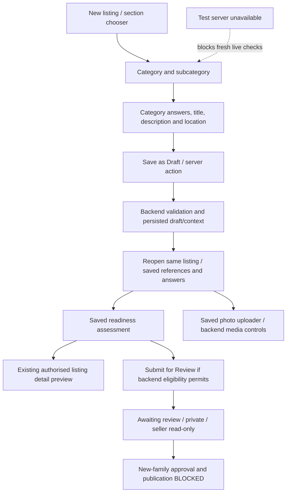

# Post Ad owner-flow verification

11 October 2026. **CURRENT: POST-AD-LIVE-02 PASS — all scoped owner draft/photo comparisons completed.** This is a draft milestone, not submission, approval, publication or public-release authorisation. Full current evidence is in section 17 and the [LIVE-02 report](../../../artifacts/evidence/post-ad-live-02/REPORT.md).

- **Automated:** fresh 614 passing tests / 37 files; live-observation assertions pass for all four families; focused lint, root/preview types, imports and whitespace pass. Hostile metadata and mismatched contract/identity fail-closed cases remain isolated-test evidence.
- **Completed live owner evidence:** exact existing Motorcycle reused; one new Cars, Property and storage-bearing Electronics Goods draft each. Normal owner row/context reads, restored forms, actual saved readiness projection and existing owner preview agree. One approved photo per draft persists across reopen/refresh and loads in both editor/gallery.
- **Blocked scoped live steps:** none within the one-path-per-family draft/photo sample. Goods deliberately lacks description and is not submission-ready; its permissive draft behavior is verified, not weakened.
- **Historical/superseded blockers:** sections 2–16 retain earlier runtime/readback/photo blockers and the runtime correction. They do not describe the current matrix result. No manifest corruption, rebuild loop or warm-up exception recurred during LIVE-02.
- **Still outside this PASS:** no submission, approval, publication or Production action; new-family approval/publication restrictions unchanged. Direct authenticated database write/security and concurrency release checks remain **DEFERRED — REQUIRED BEFORE PUBLIC RELEASE, NOT VERIFIED**. The release checklist is untouched; multiple reads do not establish an atomic snapshot or safe future approval.

## 1. Scope

Trace the existing Web owner flow for Motorcycle/Scooter, Cars, monthly rental/PG and Goods with category-defined `storage_gb`. Verify first; correct only reproduced defects. No new preview route, category/schema redesign, readiness engine, publishing architecture or Admin dependency. FairSwap-Admin and Web Admin workflows were not inspected or changed.

The previously accepted readiness correction remains the baseline. Existing evidence and the stopped verification task's deferred release checklist are retained without changing their status.

## 2. Environment / commit / branch

- Checkout: FairSwap-Web, existing dirty feature branch `codex/post-ad-a0`.
- HEAD: `c415d689124f405db56cbe8d7daecde7eeef1c29`. This identifies the committed baseline, **not** all accepted uncommitted feature work or this correction.
- Existing Test URL: `http://127.0.0.1:4318`; configured public backend URL: `https://wpppxlnbzqynvhpeuavd.supabase.co` (FairSwapTest). No Production access.
- Installed tools: Next 16.3.5, Vitest 3.2.7, Supabase JS 2.116.0. Installed executables used directly; no dependency changes.
- Browser initially reached the authenticated new-listing section chooser. After a temporary automatic-review credit failure and the user's reset, the permitted retry returned `net::ERR_CONNECTION_REFUSED`. A local listener check found no listener on 4318. The previous process's Goods/two-wheeler/Cars/Property activation flags were absent from `.env.local` and the current shell environment. Only the submission switch was found in that file. No flags were enabled to manufacture a live result.
- Existing browser sign-in did not establish that the current actor owned any particular retained listing. No credentials, cookies, tokens or session state were exported.

## 3. Flow diagram

The owner has no direct publish operation in this journey. Submit for Review is not publication. This diagram does not add an Admin step or implementation dependency.

## 4. Category verification matrix

**I** = isolated tests with controlled reads/action/RPC responses, not hosted persistence. **B** = live step BLOCKED. These are segment tests; they are not one database-backed value round trip.

| Category | Submitted/input evidence | Persisted value/readback | Restored form | Readiness projection | Existing preview display | Published/readback |
| --- | --- | --- | --- | --- | --- | --- |
| Motorcycle/Scooter (9 paths) | I: real fields/validators; Known year requires an explicit value, explicit zero km accepted; actual form sends category/version and answers | I: actual save helper's RPC arguments and controlled responses; B: no fresh database row comparison | I: actual saved editor/reference retention and same-ID/version payload; engine `125` retained through refresh | I: bound supported contract; 9 paths; seller declarations separate from catalogue facts | I: real detail page with controlled saved year `2024`, km `0`; renders `2024`/`0`, not objects | B: new-family lifecycle guards prohibit publication |
| Cars (9 paths) | I: actual controls/validators, no Known defaults; explicit petrol/manual and supported powertrain; deliberate zero range preserved | I: actual helper/reference boundary and controlled RPC; B: no fresh database row comparison | I: saved-reference retention, controlled component refresh and confirmation/cancellation cases | I: supported immutable contract and applicable declarations; all 9 paths | I: real detail page renders controlled saved year `2024`, km `0` through existing owner projection | B: new-family lifecycle guards prohibit publication |
| Monthly rental/PG (10 paths) | I: actual create/edit form; area `123.45`, separate rent/deposit/maintenance and private society payloads; exact paise | I: actual `savePropertyDraft` RPC arguments; B: no fresh database row comparison | I: actual edit retains dates, area, zero deposit, same listing ID/version through reference refresh | I: all 10 paths; source-defined fields; private society never becomes a projected answer | I: real detail page renders area `123.45`, INR `1234.50 / month`, dwelling/month basis, zero deposit and separate INR `1.23` maintenance from controlled saved data | B: new-family lifecycle guards prohibit publication |
| Goods `storage_gb` | I: existing Goods form/action and saved-field preservation tests; `storage_gb=256` specifically exercised as a controlled saved category-defined value | B: no live storage-bearing category/record verified; no fresh `256` save/readback claimed | I: generic category-defined saved scalar restoration; no specific live `storage_gb` reopen | I: actual evaluator/strict DTO keeps label `Storage (GB)` and value `256`; nested/private/unrecognised values excluded | I: actual detail page keeps `Storage (GB): 256` using controlled category definitions | B: no fresh approved owner record/readback; existing Goods lifecycle unchanged |

Original CSV taxonomy and path arrays were not expanded. Isolated path coverage does not prove every live category remains selectable.

## 5. Persistence / readback findings

Source trace:

- `src/app/account/listings/new/page.tsx` authenticates the request and loads existing section/reference/location sources. `GoodsPostAdEntry.tsx` supplies the category selection and common input preservation.
- `ListingForm.tsx` validates category answers, sends explicit category/version context and saved financial declarations, creates a draft once, then reopens the acknowledged listing ID. Photos are attached to saved listings, not fabricated for an unsaved form.
- `src/app/account/listings/actions.ts` checks maintenance, current policy acceptance and authentication before draft writes. Vehicles delegate to `saveVehicleDraft`; Property to `savePropertyDraft`. Goods retains its existing validated insert/update path.
- `src/lib/listings/two-wheeler/server.ts` uses `save_two_wheeler_draft` / `save_car_draft`; `property/server.ts` uses `save_property_draft`. Backend functions enforce owner/account/policy, saved version/category and lifecycle constraints independently of browser state.
- `src/app/account/listings/[id]/edit/page.tsx` reads the persisted row, owner-private location, saved family context and media. Saved references determine the form. Pending new-family records render `PendingOwnerListing`, not an editable form.

Controlled payload/restoration tests pass. **Fresh hosted persistence/readback: BLOCKED, not verified.** Older accepted draft/submission reports remain historical evidence; they are not promoted into a current end-to-end pass. No saved fixture was altered or re-submitted.

## 6. Readiness findings

Existing `loadOwnerReadiness` / `evaluateReadiness` were exercised unchanged in behavior. Category-defined `storage_gb` survives. Private names, arbitrary keys and nested Goods metadata do not become answers. Family binding checks include saved key/family/path/ordered fields/immutable definition, plus Property basis definition. Unsupported or modified contracts remain `not_verified`. Photo checks and captured provenance remain independent.

Title/description bounds and plain-text rendering remain intact. Missing and empty descriptions remain distinguishable. Saved validity, approved Test submission minimums, unresolved public pricing/evidence/approval policy, transition availability and freshness are still separate. A multiple-read or consistent calling-statement assessment is not proof of safe future approval.

## 7. Preview findings

The existing preview is `/listings/[slug]` with its existing visibility/owner checks, not a new Post Ad feature. The saved owner assessment/typed packet is another read-only saved-data surface, not publication.

**Defects reproduced against the actual detail page before correction:**

1. Its raw `Object.entries(category_attributes)` loop displayed undeclared `ARBITRARY_VALUE`, private `PRIVATE_VALUE`, and `[object Object]` for nested metadata.
2. Known Vehicle answers rendered as `[object Object]`, losing explicit year/km values.
3. Property's deliberately NULL generic item price produced `Price on request` despite a saved known monthly rent.

Four regressions failed before the runtime change. After correction, the real detail page uses category-defined safe scalar membership/labels for Goods/legacy. Existing authorised owner previews reuse the existing server-produced readiness packet for family declarations and rental financials. It does not introduce a readiness engine or infer permission from a client/category flag.

The packet must match listing ID, category, status, revision, update identity, title and description, have a supported contract, and not have a snapshot mismatch. A mismatch/unsupported contract withholds specifications and marks amount verification unavailable; it never falls back to raw fields. These comparisons prevent rendering a different captured record as the current preview, **not** claiming an atomic read or safe future approval. Independent photo gallery presentation remains available.

Known rent/basis/period, optional one-time zero deposit and separate monthly maintenance remain distinct. Missing description uses the existing explicit absence notice, without changing or synthesising saved seller text. Existing SEO fallback metadata is unchanged and is not substituted into the saved advertisement.

**Live corrected preview comparison: BLOCKED, not verified.**

## 8. Publish findings

There is no direct seller publish button/action. `submitListingAction` calls existing backend eligibility and `seller_submit_listing`; it moves an eligible draft to `pending_review`, not public visibility. It forwards the saved revision and does not use the readiness panel as authority.

The existing `20261011092234_test_family_submission_v1.sql` restricts new-family lifecycle to draft/pending and explicitly rejects approval/publication. SQL was inspected as source only, not executed. No publication attempt was appropriate under those restrictions. No gate was enabled, and no submission was replayed to approximate publication.

**Published record equality: BLOCKED, not verified.** Goods publication rules were not changed. Current public visibility continues through `is_listing_publicly_visible`; no visibility authorization code was altered.

## 9. Security observations

- Existing backend/server auth, ownership, account/policy and lifecycle controls remain authority; client flags and readiness outcomes cannot authorize writes/publication.
- Actual evaluator/DTO/page tests exclude private/unrecognised/nested metadata while retaining category-defined capacity. Invalid contract evidence does not erase photo presentation/state.
- Actual page tests keep supplied HTML-like title/description as text, without creating script/bold elements.
- Generic definition read failure withholds raw specifications. Owner packet identity/definition/snapshot failures withhold values rather than silently trusting them.
- Private society, PIN/landmark/address storage and owner-only reads remain unchanged. The page correction does not add private-data reads to public display.
- Hosted JWT/RLS, direct write denial and simultaneous transactions are **not proven** by mocks. The separate release checks remain **DEFERRED — REQUIRED BEFORE PUBLIC RELEASE, NOT VERIFIED**, with their existing checklist untouched.

## 10. Automated test evidence

- Before: **4 failed / 0 passed** in `tests/unit/owner-listing-display.test.tsx`, actual page with isolated saved rows and reference reads. An earlier one-case reproduction also failed on the three leaked render values.
- After: **13 display tests passed**, covering all four category examples, unknown/changed contracts, revision/status/text/snapshot mismatches, failed reference reads, photo independence, plain-text/missing description and separate rental financial concepts.
- Existing Post Ad owner regression selection: **567 passed / 34 files**, including current readiness projection/loader/component tests, all family contracts, real forms, category independence, saved-reference retention, session-independent action/media guards and publication source checks. Final machine-readable results: [tests.json](../../../artifacts/evidence/post-ad-owner-flow/tests.json). Admin test files and live/SQL suites are excluded.
- Separate focused run: **67 passed / 5 files** (display 13, session/cookie boundaries 7, uploader 10, seller media API 34, public location privacy DTO 3). Counts overlap the broad run; they are not summed. Existing GoTrue multiple-client warnings and expected simulated outage logs occurred in isolated tests.
- Full-checkout ESLint passed; final changed-file lint passed; root and existing preview typechecks passed; Goods/preview import graphs passed (37/18 modules); tracked/focused whitespace checks passed.
- The first root typecheck identified the existing privacy DTO fixture missing the two newly selected read identity fields. Only that fixture's revision/update timestamp was supplied, then typecheck passed. No privacy expectation was weakened.

No historical SQL harness, hosted mutation/concurrency probe, Admin suite, dependency installation or Production build/access ran.

## 11. Live verification evidence

The already-authorised Playwright mechanism was used, without extracting credentials. Initial GET `/account/listings/new` rendered signed-in account navigation and Goods/Vehicle/Property section links. Snapshot evidence: `.playwright-mcp/page-2026-10-11T13-13-10-614Z.yml`; this captures the chooser, not saved values or persistence success.

The first next navigation was not executed because automatic approval review could not complete due to workspace credits. After the user reported reset, the same navigation was retried normally. Actual result: `net::ERR_CONNECTION_REFUSED` for `/account/listings/new?macro=vehicles`. This replaced the credit failure with an actual unavailable-runtime blocker; no alternate transport bypass was attempted.

No current-session saved-record readback, preview comparison, photo upload/change, save, submit or publish executed. No private values, credentials or raw authenticated API requests are retained in this note.

## 12. Blockers / minimum unblocking actions

| Status / exact step | Dependency | Already proven by tests | Remains unverified | Minimum action |
| --- | --- | --- | --- | --- |
| **BLOCKED** — steps 2–4 after initial chooser | Previous Test server on 4318 is no longer listening; prior family runtime flags are absent from current config | Real selection/components, independent references, controlled inputs and validation | Current live category selections/input flow for each matrix row | Restore the previously approved FairSwapTest development runtime/configuration, with the normal approved owner session; no Production or new gate approval implied |
| **BLOCKED** — steps 5–8 | Available authenticated Test server, an owner-controlled test draft and working Test media processing | Real form/helper payloads, saved-reference restoration, isolated media guards/uploader/recovery | Fresh save/database readback/reload equality, photo upload/change/restore and specific live storage-bearing category | Once runtime is restored, identify the owner/session and storage-bearing category; perform a bounded synthetic owner draft round trip without modifying retained fixtures |
| **BLOCKED** — steps 9–11 live | Same Test runtime plus persisted owner data | Real readiness evaluator/loader/DTO and corrected existing detail page | One same-record saved → restored → readiness → preview comparison using hosted data | Read the newly saved owner draft through existing owner routes after the round trip |
| **BLOCKED** — steps 12–13 for new families | Existing database publication restriction; no seller direct publish operation | Source guards and isolated publication/submit boundaries | Published/readback equality | A separately approved publication scope/policy; do not activate it for this verification or introduce Admin dependency |
| **BLOCKED** — specific live `storage_gb` contract | No current live category definition/owner record was inspected | Defined scalar `256` survives evaluator, strict DTO and real page; nested/private values excluded | Hosted category availability and persisted/restored/displayed storage value | Identify an existing Test category actually defining `storage_gb` once the runtime is available; do not invent/import one |

## 13. Defects fixed / affected files

- `src/app/listings/[slug]/page.tsx`: replace unbounded raw specification rendering; reuse trusted matching owner projection for existing preview; correct saved rental display.
- `src/lib/discovery/queries.ts`: select/return existing `revision` and `updated_at` in the detail read so the preview can compare record identity.
- `src/lib/listings/submission-readiness.ts`: export the existing unchanged metadata-name predicate for reuse; no evaluator/validator behavior change.
- `tests/unit/owner-listing-display.test.tsx`: real-page reproductions and focused regressions.
- `tests/security/public-location-privacy-app.test.ts`: add existing identity fields to one typed mock; privacy assertions unchanged.
- This verification note and local test evidence. No other implementation file was changed for this task.

No SQL/RPC/RLS/grant, auth role, category activation, monetary constraint, transition, notification, fixture/photo, publication or Production change. Four submitted fixtures and older accepted drafts received no mutation requests. Their current inventory was **not** revalidated live; this task does not claim a fresh preservation hash. Retention/session recovery behavior is covered by isolated regressions. No Docker, dependency upgrade, commit, push or deployment.

## 14. Final status / next task

**PASS WITH LIVE-ENVIRONMENT BLOCKER.** Proven display defects are corrected and automated checks pass. End-to-end hosted persistence, media, preview equality and publication/readback remain explicitly unverified; this is not a public-release pass.

Recommended next Post Ad task: restore the previously approved Test owner runtime/session and complete one bounded draft save/reopen/readiness/existing-preview comparison per matrix family, including a real storage-bearing Goods category and approved photo. Keep publication and the separately deferred database/write/concurrency checklist closed until separately scoped authorization. Do not start Admin work.

## 15. POST-AD-LIVE-01 — approved runtime recovery and bounded live attempt

### Baseline and runtime

Same checkout, branch and HEAD as section 2. [Baseline](../../../artifacts/evidence/post-ad-live-01/baseline.json) records SHA256 for 340 existing source/test/migration/configuration/evidence files, including `.env.local`, the approved launcher, this note and retained release documents. The complete dirty status and focused preview patch were captured alongside it. Before this note update, **all 340 hashes matched**; no implementation, test, SQL, configuration or retained report was changed by this attempt. No reset/stash/clean occurred.

The missing 4318 listener was recovered using the already documented `artifacts/post-ad-preview/start-property-test.mjs`, referenced by existing `post-ad-journey/runtime-target.json`. Installed Next 16.3.5 started ready in 2.9 seconds. The launcher privately verified existing credentials against FairSwapTest project `wpppxlnbzqynvhpeuavd`, then reused its established child-only family configuration. No environment file, submission/publication gate or database state was changed to start it. Why the earlier process disappeared remains unknown.

The normal authenticated new-listing route rendered all 18 vehicle paths. The ordinary owner browser identity matched the previously approved fixture owner via normal owner authentication/profile reads. The separate non-owner context was retained; no new sign-in, credential extraction or elevated client was used for owner readback. Existing Goods `category_attributes` returned a real numeric `storage_gb` definition labelled **Storage (GB)** for category `fa5df00f-6de5-41d6-88f4-6660be6aba47`. Its selectable path was not yet verified.

### Live comparison matrix

**Browser** means actual owner UI/server-rendered route evidence. **Owner row read** means a direct ordinary-owner client comparison; it is separately identified and never replaced with service-role access. Machine-readable sanitized observations: [live-results.json](../../../artifacts/evidence/post-ad-live-01/live-results.json).

| Family / real path / same-record identity | Entered values | Persistence and restored form | Saved readiness | Existing owner preview | Photo / result |
| --- | --- | --- | --- | --- | --- |
| Motorcycle: Vehicles → Motorcycles → Commuter Bikes; category `94969a67-4d44-4e2a-81e3-0ece8d6de153`; listing `08119b0b-2630-479e-9c14-f098c154749c`; saved `two-wheeler-draft-v1`, version `0506a02a-b66a-4abe-b168-db58eb87c43d`, draft revision 2 | Explicit Known year `2024`, Known km `0`; Not listed brand `Synthetic LIVE01 Brand`, model `Synthetic LIVE01 Motorcycle`; title `SYNTHETIC POST-AD-LIVE-01 Motorcycle`; description `Synthetic Test draft round trip only. Saved <b>plain text</b>; not for sale.`; INR `1234.50`, condition good; existing locality selected | One Save click. Automatic navigation wait timed out at 90 seconds; **no second Save**. My Listings subsequently showed this exact ID, Draft, revision 2. Reopen and explicit refresh returned HTTP 200 with equal title/description, year `2024`, km `0` and the same category. Saved routes prove persistence of the observed values; **complete independent row/context comparison did not finish**. One authenticated edit GET returned HTTP 500 while its partial server-rendered response contained matching title/year/km and saved slug. | Actual saved panel: category/version binding, immutable supported definition, common saved values, vehicle answers and year/km minimum Pass. No ready photos correctly Needs attention. Captured draft revision 2 and saved version above. Multiple-read/no atomic snapshot guarantee retained. Test submission availability reported; no transition attempted. | `/listings/synthetic-post-ad-live-01-motorcycle-577927` rendered existing private owner preview, title/description equal, Year `2024`, Km Driven `0`, ₹1,234.5. Literal `<b>` remained text; zero injected bold elements. No raw nested specifications appeared in observed output; no hostile metadata was injected live. | Both surfaces correctly show no photos. No upload. **Partial PASS; full readback/photo round trip BLOCKED**. |
| Cars | Not entered; no new record | Not executed | Not executed live | Not executed live | **BLOCKED** by runtime instability; isolated evidence in section 10 remains distinct. |
| Monthly rental/PG | Not entered; no new record | Not executed; no private society/location comparison | Not executed live | Not executed live | **BLOCKED** by runtime instability; no assertion of live private-field success. |
| Goods `storage_gb` | Real owner-readable definition identified above; no synthetic `256` draft created | Selectable path/save/reopen not executed | Not executed live | Not executed live | **BLOCKED**; definition availability alone is not the required value round trip. |

### Exact blocker and safe stopping point

The server repeatedly rebuilt without implementation edits. Three ordinary-owner client read evaluations were interrupted by `Execution context was destroyed, most likely because of a navigation`; none supplies a completed row comparison. Server output reported **Manifest file is empty**, **Unexpected end of JSON input**, and **The destination stream closed early**, with intermittent edit-route HTTP 500 responses. Browser console showed repeated Fast Refresh rebuilding. The existing separate sample-preview process uses `tools/post-ad-preview` on 4317; process inventory alone does **not** establish it as the cause. No application root cause or code defect was proven, so no speculative fix was made.

Successful HTTP 200 refresh/preview observations do not erase these intermittent failures. Further draft creation and photo upload were paused to avoid ambiguous saves. The existing harmless synthetic photo was inspected and available, but not uploaded. No undocumented flags, watcher bypass, cache deletion, dependency replacement or process termination was used to manufacture a pass.

**BLOCKED:** complete ordinary-owner row/context readback, stable same-record round trips for Cars/Property/Goods, and photo persistence. Minimum safe action: diagnose and stabilise the existing approved 4318 Next development runtime/manifest rebuild behaviour, preserving the baseline and existing sessions. Then resume the existing fresh Motorcycle ID first; do not create a duplicate. Complete the other three bounded synthetic drafts and photo comparison only once reads/navigation remain reliable. No new credentials, infrastructure or Admin dependency is required by this evidence.

### Tests, privacy and preservation

The current attempt reran the actual owner detail page, readiness projection and readiness evaluator regressions: **85 passed / 3 files, zero failures**; results are recorded in [tests.json](../../../artifacts/evidence/post-ad-live-01/tests.json). These are isolated dependencies, not hosted write/RLS proof. Previous 567-test owner suite, lint/type/import results remain historical evidence from section 10, not a fresh live pass. `git diff --check` passed in this attempt. No source change required new lint/type/import or regression-first code correction.

Existing corrected preview/projection source was confirmed present and unchanged. Live plain-text rendering and absent photos were observed on the fresh Motorcycle; failed identity/revision/definition/snapshot cases and arbitrary/private/nested exclusion remain isolated-test evidence. No adversarial metadata, retained fixture mutation, submitted draft edit, notification, submission, approval or publication occurred. The four submitted fixtures and older accepted drafts received no mutation requests; their current hosted inventory was not revalidated. SQL/RPC/RLS/grants, pricing policy, retention/session recovery, private-data permissions and publication gates remain unchanged. No Admin, Production, Docker, dependency upgrade, commit, push or deployment.

The stopped direct authenticated database write/security and concurrency checks remain **DEFERRED — REQUIRED BEFORE PUBLIC RELEASE, NOT VERIFIED**. Their existing release checklist is untouched. A successful draft comparison would **not** authorise publication of new-family listings.

**Final status: BLOCKED — partial live evidence.** Recommended next Post Ad task: a bounded diagnosis of the approved Test runtime's repeated rebuild/manifest failures, followed by completion of this same draft-only matrix. No next task was started automatically.

## 16. POST-AD-RUNTIME-01 — runtime stability and same-record read-only comparison

**PASS — bounded runtime scope only.** Full findings, limitations, precise diff and evidence: [runtime report](../../../artifacts/evidence/post-ad-runtime-01/REPORT.md).

The actual installed Tailwind/PostCSS compiler registered `.playwright-mcp` snapshots and a directory dependency as CSS sources. Installed Next's PostCSS loader passes directory dependencies to webpack without applying the Tailwind extension glob. Fast Refresh console writes in that directory therefore triggered another layout/CSS build and another console write. Idle filesystem sampling reproduced the loop without new implementation edits or navigation. Root and sample-preview outputs are separate, with no links between them; no evidence implicated the 4317 process or OneDrive synchronization as the cause.

The smallest verified correction adds `/.playwright-mcp/` to `.gitignore`; it retains all evidence while excluding generated browser files from automatic class detection. The real compiler regression failed before (8 generated dependencies, expected 0) and passes after, retaining actual Post Ad component discovery/CSS. Only the identified 4318 process tree was restarted via the unchanged approved Test launcher, ready in 2.8 seconds. No cache deletion, output-directory change, new flags, environment-file edit or unrelated process termination occurred.

Startup/warm-up logged two server exceptions (`The destination stream closed early`, `__webpack_modules__[moduleId] is not a function`); those are disclosed rather than counted as error-free startup. A separate settled-request run then completed **three consecutive cycles**: authenticated new route → Motorcycle edit → explicit refresh → ordinary-owner row/context reads → existing owner private preview. All document responses were HTTP 200. The final monitor recorded 27 relevant responses, **zero HTTP 500** and six component-cancelled reference fetches; no document or owner readback failed. Final server window: zero new errors, manifest failures or Fast Refresh rebuilds. A 15-second idle sample found all three manifests unchanged and valid across 140 sample rounds; 11 deliberate synthetic excluded-log writes also left the build manifest unchanged. This is bounded stability evidence, not an indefinite-uptime guarantee or a diagnosis of every possible cold-start exception.

Independent normal-owner row/context queries now completed for listing `08119b0b-2630-479e-9c14-f098c154749c`: still draft revision **2**, same category/version, year Known `2024`, kilometres Known `0`, Not listed synthetic Brand/Model, equal title/description, item `123450` paise, condition `good`, cover NULL. Restored year/km and existing private preview agree across all three cycles. No elevated client substituted for owner/RLS readback; the preview's existing internal server reads remain unchanged. Safe comparison details: [stable-cycles.json](../../../artifacts/evidence/post-ad-runtime-01/stable-cycles.json).

Checks: actual compiler regression **1 passed** after reproduced failure; actual owner display/readiness selection **85 passed / 3 files**; focused ESLint, root/preview typechecks, Goods/preview import graphs (37/18) and whitespace checks passed. Baseline hashes preserve existing Post Ad implementation/SQL/configuration and retained evidence; only this note and the deliberate `.gitignore` correction changed, plus new runtime evidence/test/report. No Save, upload, submission, approval, publication, fixture mutation, Admin, Production or gate change. Four submitted fixtures were not re-audited and received no mutation requests from this task.

Stop after runtime/read-only verification. Recommended separately scoped continuation: finish the remaining draft-only category/photo matrix, resuming the same Motorcycle ID rather than creating a duplicate. The release checklist remains **DEFERRED — REQUIRED BEFORE PUBLIC RELEASE, NOT VERIFIED**. Runtime success does not authorise publication.

## 17. POST-AD-LIVE-02 — complete bounded owner draft/photo matrix

**PASS — scoped draft-only matrix.** Same dirty branch/HEAD; runtime correction retained; normal approved owner authenticated. No startup/configuration change required. [Report](../../../artifacts/evidence/post-ad-live-02/REPORT.md), [actual live comparisons](../../../artifacts/evidence/post-ad-live-02/live-comparisons.json), [final explicit reopens](../../../artifacts/evidence/post-ad-live-02/final-reopens.json) and [comparison assertions](../../../artifacts/evidence/post-ad-live-02/comparison-assertions.json).

| Actual path / listing | Persisted, restored, projected and preview values | Photo / revision / result |
| --- | --- | --- |
| Vehicles → Motorcycles → Commuter Bikes / `08119b0b-2630-479e-9c14-f098c154749c` (reused) | Known year 2024 and km 0; previous synthetic Not listed Brand/Model, title/description and INR 1234.50 unchanged. Existing `two-wheeler-draft-v1` version `0506a02a-b66a-4abe-b168-db58eb87c43d` agrees with owner context/readiness. | One ready associated photo; loaded editor/preview; draft revision **2 → 5** after upload. **PASS**. |
| Vehicles → Cars → Electric & Hybrid Cars / `6c89bf30-9576-4efa-a836-7a32fff2be7a` | Explicit Known battery-electric powertrain, battery 60 kWh, year 2024, km 0, electric-only range 0, registration Unknown; item INR 1234.50. Saved `cars-draft-v1` version `7b71b6fd-0b82-4881-8db4-ccaa847bab8e`. Empty Known powertrain placeholder observed before deliberate selection; no default fact created. | One create mutation, one ready photo; editor/gallery loaded; draft revision **2 → 5**. **PASS**. |
| Property → Residential for Rent → Apartment or Flat / `61091435-50d8-4cda-8723-e690f366b7bc` | Area 123.45 square feet (`area_sqft`), carpet basis. INR/month/dwelling rent **123450 paise**, one-time deposit **0**, separate monthly maintenance **123 paise**; item price NULL. Restored deposit formats as 0.00; preview separates INR 1234.50/month, INR 0.00 deposit, INR 1.23/month/dwelling maintenance. `property-rental-draft-v1` version `87867d25-57f8-41b2-a338-73477b6ceabe`. | One create mutation, one ready photo; editor/gallery loaded; draft revision **2 → 5**. Private synthetic society/location restored for owner, absent from readiness/public-detail preview HTML. **PASS**. |
| Goods section → Electronics / `2d257a5a-1d3b-4e82-ba30-2bb43e8cbdd5` | Existing selectable category `fa5df00f-6de5-41d6-88f4-6660be6aba47`; actual contract **existing-goods / version NULL / existing category definitions**. Numeric `storage_gb=256`, label **Storage (GB)** and definition order retained. INR 1234 / 123400 paise. Missing Model excluded; blank description → NULL → blank editor → NULL packet → explicit absence notice. | One create mutation, one ready photo; editor/gallery loaded; draft revision **1 → 1** after upload. Missing description correctly flagged for submission completeness. **PASS for draft flow**, not submit-ready. |

The approved existing harmless photo was uploaded once to each draft via its normal owner input (HTTP 201/ready). Ordinary-owner media rows match each exact listing ID, count one, order zero; readiness count/ready one agrees. All persisted cover references remain **NULL**, accurately reported; no cover mutation was needed to display the gallery. The final four exact edit reopens and explicit refreshes returned HTTP 200 and loaded the photo. Photo persistence evidence does not establish complete media/context revision coverage; Goods revision remaining 1 reinforces the retained freshness warning.

Goods initially received a Save **click** with INR 1234.50; its existing whole-rupee `step=1` control blocked native submission, and the edit-URL wait timed out. Normal owner lookup confirmed no matching row before another click. Supported input INR 1234 then produced the one acknowledged draft. No amount rule, validator or conversion was changed; no duplicate save occurred. Cars and Property each used one Save/create; Motorcycle used no Save/update, only its expressly authorised upload. Two read-only automation inspection errors were corrected without saves; none was a runtime application failure.

Actual readiness props are server-produced data from the existing owner form, inspected without rewriting state or adding a readiness engine. Family ID/category/version/revision/advertisement and financials match ordinary-owner backend reads. Goods uses its real existing definitions rather than a fabricated immutable version. Private Property equality checks are recorded as booleans; no real address/contact was entered. Arbitrary/private/nested hostile metadata and stale/unsupported contracts remain exercised by the actual isolated projection/page tests, not injected into hosted records. No elevated read substituted for owner/RLS checks. Existing preview internal reads/visibility behavior remain unchanged.

Fresh verification: **614 passed / 37 files** (actual owner/input/contracts/retention/readiness/display plus uploader/media/privacy regressions); root/preview typechecks, focused lint, import graphs (37/18) and whitespace pass. [Tests](../../../artifacts/evidence/post-ad-live-02/tests.json). Scoped live assertions pass for four families. [Runtime log summary](../../../artifacts/evidence/post-ad-live-02/runtime-summary.json): zero new errors, manifest/partial-JSON failures or Fast Refresh rebuilding messages from preflight through final reopens; earlier warm-up exceptions did not recur. No historical SQL or live write/concurrency/security suite ran.

No implementation or test change was needed; only new evidence/report and this authorised note update. Baseline hash comparison preserves existing source, SQL, configuration, runtime correction and retained release evidence. Four submitted fixtures/older accepted drafts received no mutation requests; their hosted inventory was not re-audited. No submission, notification, approval, publication, Admin, Production, SQL/RPC/RLS/grant, category/reference, lifecycle gate, environment/dependency, retention/session recovery, commit/push/deploy or Docker change.

**Final status: PASS — all scoped draft and photo comparisons completed.** This verifies one supported path per family, not every live taxonomy path or public release. Direct database write/security and concurrency prerequisites remain **DEFERRED — REQUIRED BEFORE PUBLIC RELEASE, NOT VERIFIED**, with their checklist retained. Existing Goods behavior stays unchanged; new-family approval/publication and Production activation remain disabled.

Exact recommended next task: **POST-AD-RELEASE-PREREQUISITES-01 — read-only review of remaining public-price, evidence and approval-policy decisions and the deferred release prerequisites; no gate activation or verification replay.** Stop here; no next feature was started.
