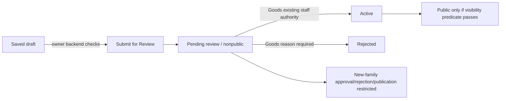

# Post Ad release prerequisites review

11 October 2026 · POST-AD-RELEASE-PREREQUISITES-01 · **REVIEW COMPLETE**. This is a source/evidence review, not release approval.

## Executive summary and baseline

The accepted owner draft milestone remains verified for one actual path each in Motorcycle, Cars, monthly Property and Electronics Goods. Test seller submission is implemented and historically demonstrated on four separate synthetic records. New-family approval, rejection and publication are deliberately restricted. Public pricing, classification evidence and future approval freshness are not settled by draft success. All five deferred security requirements remain **DEFERRED — REQUIRED BEFORE PUBLIC RELEASE, NOT VERIFIED**.

Repository: `C:/Users/VivekKumar/OneDrive - Nobly A S/Documents/FairSwap` (FairSwap-Web). Branch `codex/post-ad-a0`; HEAD `c415d689124f405db56cbe8d7daecde7eeef1c29`. The worktree contains accepted tracked modifications and untracked source, tests, migrations, tools and reference documentation; HEAD alone does not identify this implementation. Before writing these two reports, an in-memory SHA-256 inventory covered 716 existing source/test/SQL/reference/evidence/configuration files, aggregate digest `CC187ABCDD1FD30EC0A13883BEB864DD03C4968FAD784BF2819F544EC0BB4DEA`. Environment secrets were not read. Only this document and the companion evidence report may change.

No browser, hosted service, SQL execution, mutation, test replay, configuration change or Admin implementation was performed. Separate FairSwap-Admin source/UI/permissions were not inspected in this task. Historical descriptions of that checkout are attributed to the prior contract, not represented as fresh inspection. The retained Web moderation caller and existing database operations were read as source.

## Source inventory and authority

References below are repository-relative paths with exact line or symbol anchors. Historical recommendations are not approvals; later implemented Test rules supersede earlier descriptions of disabled submission, missing staff projections and raw detail rendering.

| ID | Source reviewed / anchor | Authority and limits |
| --- | --- | --- |
| E1 | `docs/reference/post-ad/Post-Ad-Owner-Flow-Verification.md:213`, section 17; `artifacts/evidence/post-ad-live-02/REPORT.md`, Live matrix, Media and save safety, Runtime and checks | Latest hosted owner draft/photo evidence; 614 tests/37 files and checks are retained results, not rerun here. |
| E2 | `artifacts/evidence/test-submission-v1/VERIFICATION-RESUME.md:161`, retained checklist, plus Historical evidence, authenticated close-out and staged action follow-up | Exact stopped task and five deferred requirements; historical four submissions, anonymous/owner/non-owner read evidence, isolated 1,199 SQL assertions, generic Web rejection and fixture preservation. Not full authenticated database-write proof. |
| P1 | `docs/reference/post-ad/Post-Ad-Submission-Review-Contract.md`, family table, Review freshness and transitions, Only unresolved product decisions | Existing Goods rules; earlier family recommendations and unresolved public policies. Future implementation descriptions are historical, not the current deployment inventory. |
| P2 | `docs/reference/post-ad/Post-Ad-Journey-Acceptance.md`; `Post-Ad-Readiness-Verification.md`, Rule authority and subsequent corrections; `csv-mapping/Two-Wheeler-V1-Verification.md`; `csv-mapping/Cars-V1-Verification.md:130`; `artifacts/evidence/property-v1/report.json`, authority/testDecisions | Accepted draft contracts, source classifications, financial/privacy decisions and their evidence limits. No expanded CSV taxonomy. |
| W1 | `src/types/listing.ts:248`, `draftListingSchema`, `submitListingSchema`; `src/components/listings/ListingForm.tsx:176`, `:190`, `:474`; `ListingFormFields.tsx:62` | Common draft/submission schema; existing Goods conversion and whole-rupee input; exact Vehicle amount path and rental authority. |
| W2 | `src/lib/listings/two-wheeler/contract.ts`, `validateVehicleSubmission`, `rupeesToPaise`; `cars/contract.ts`, `validateCarAnswers`; `cars/answer-options.ts`; `property/contract.ts:5`, `:12`, `:18`, `:38`, `propertyRentSummary` | Supplied-answer validity, explicit states/dependencies, safe-integer representation, exact paise and rental basis. |
| W3 | `src/lib/listings/submission-readiness.ts:81`, `supportsSavedContract`, checks at `:98`, `:103`, `:120`, `:134`, `:145`, `:148`; `readiness-server.ts`, `loadOwnerReadiness` | Read-only assessment, safe category-defined projection, independent photo state, policy_pending and freshness warnings. Owner read is multiple reads. |
| W4 | `src/app/account/listings/actions.ts:232`, `submitListingAction`; `src/lib/listings/submission-server.ts`, `loadSubmissionState`; `test-runtime.ts`, `isVerifiedSubmissionTestEnvironment`, `requiresSavedSubmissionFamilyReads` | Server transition routing/availability, not client permission. Installed Test family capability remains checked with activation switches OFF. |
| W5 | `src/lib/media/api-contract.ts:216`, `verifySellerMediaMutationGuard`; `src/lib/listings/saved-submission-family.ts`, `hasSavedSubmissionFamily`; `src/app/api/listings/[id]/media/route.ts:171` | Account/policy/ownership/status before upload; authenticated media insert, server-mediated private storage and processing RPC. Required context errors fail closed. |
| W6 | `src/app/listings/[slug]/page.tsx:113`, `:139`, `:300`; `src/lib/discovery/queries.ts:301`; `src/components/listings/ListingCard.tsx:13` | Bound owner preview, distinct rental concepts; public visibility check; current cards/discovery still use generic item pricing. No demonstrated public new-family projection. |
| D1 | `supabase/migrations/20261011092234_test_family_submission_v1.sql:21`, `:45`, `:77`, `:113`, `:176`, `:408`, `:637`; `20261011095100_enable_test_family_submission_v1.sql` | Installed Test policy, parent/child locks, lifecycle restrictions, owner/revision submit, preserved Goods branch, worker-only pending completion and eligibility read. Applied historically, not executed now. |
| D2 | `supabase/migrations/20261007153744_atomic_reviewed_moderation.sql:1`; `20260914000008_create_listing_rpcs.sql:368`; `src/app/admin/listings/actions.ts:25` | Reviewed wrapper locks/compares expected revision/status, PT409; original moderation approves/rejects; retained Web caller still uses unreviewed `moderate_listing`. Source integration gap, not a live approval defect demonstration. |
| D3 | `supabase/migrations/20260914000006_create_listing_media.sql:139`; `20261002000033_seller_media_management.sql:28`, `:138`, `:297`, `:346`, `:578`; D1 child/worker triggers | Legacy media re-review applies active/reserved/paused; pending Goods media does not acquire complete revision coverage. New-family parent changes are scoped separately. |
| D4 | `supabase/migrations/20260918000021_policy_reacceptance_records.sql:324`, `:834`; `20261001000031_harden_public_listing_location_privacy.sql`, `get_seller_listing_location_private`; `20261010084523_property_rental_draft_v1.sql:14`; `20261010214201_staff_listing_review_context.sql:6`, `:74`, `:114`, `:126` | Public active/unexpired/active-seller predicate, owner/current-policy RLS, owner-only society, bounded staff AAL2/non-self/pending statement-snapshot projection. Statement consistency is not future approval safety. |
| D5 | `supabase/migrations/20260914000007_create_storage_buckets_and_policies.sql:5`; `20261007153735_admin_pending_medium_download.sql:1`; `20261007161425_admin_pending_medium_download_info.sql` | Private originals/derivatives and server mediation, with narrow later authenticated staff medium/download-info exceptions; not a public bucket or broad owner Storage grant. |

## Pricing policy matrix

**Already implemented/approved** below means the existing Goods rule or accepted Test rule. It does not approve new-family public market policy.

| Family | Saved amounts and input precision | Missing/zero/Unknown and submit minimum | Readiness / display / policy status |
| --- | --- | --- | --- |
| Goods/legacy | W1: integer `price_paise`, INR presentation; fixed/negotiable/free. Existing Web schema max 100,000,000 paise (₹10 lakh). Native form `step=1`; existing Goods parse/round conversion unchanged, not the Vehicle exact-decimal parser. | Draft may omit amount/type. Submission needs type, condition and positive non-free amount; free form writes 0. NULL is not Free. No separate Unknown amount declaration. Missing description stays NULL and blocks submission. | W3/W6: item completeness separate from amount projection; Free, amount, or Price on request. LIVE-02 verified ₹1,234→123400 paise; initial decimal input was blocked natively, not a server failure. **Decided/implemented; sample verified. Preserve Goods behavior.** |
| Motorcycle/Scooter, 9 paths | W2/W1: exact INR text ≤2 decimals→integer paise, existing Test ₹10 lakh cap; fixed/negotiable/free. | Draft blank amount permissible; submission requires common item fields and positive non-free amount, free=0. Year/km may be explicit Unknown; zero km is valid and unrelated to monetary zero. | E1 verified ₹1,234.50→123450 paise through restore/readiness/owner preview. **Public cap and free/negotiable offer policy require Product approval (R1); current Test cap is not public policy.** |
| Cars, 9 paths | Same common item currency/conversion/Test cap as Motorcycle; category/segment does not alter price policy. | Same common amount minimum. Applicable Unknown fuel/transmission/powertrain accepted under Test rules; valid explicit range 0 is not a free price or Unknown. | E1 verifies 123450 paise; W3 keeps price-policy pending separately from valid answers. **Public amount policy unresolved (R1); no segment-derived ceiling.** |
| Monthly rental/PG, 10 paths | W2/D1: `listing_property_contexts.financial` is sole financial authority: INR, month, compatible dwelling/advertised-room/per-bed/occupant-share basis. Exact ≤2-decimal text→whole paise; 9,007,199,254,740,991 paise is only a safe-integer limit. Generic condition/type/price NULL. | Draft rent unanswered/Unknown allowed without amount; Test submit requires Known positive rent and basis. Optional one-time deposit may be Unknown/unanswered or Known 0. Optional maintenance may be Unknown/unanswered/included/none, or separate positive monthly amount with matching basis. No lumped total; no rent-on-request Test submission. | E1 verifies rent 123450, deposit 0, maintenance 123 paise independently. Owner detail renders period/basis and separate charges. W6 cards/search still use generic item price; NULL cannot be a public rental price authority. **Public financial limits and approved rental discovery projection remain unresolved (R1/R5).** |

No currency expansion, rounding change, new ceiling or mandatory optional charge is recommended as an implicit implementation default.

## Evidence/media policy matrix

| Scope | Already implemented/approved | Verification / remaining gap |
| --- | --- | --- |
| Submission photos | W3 `photos.submission`/`maximum`, D1:176: ≥1 ready photo, ≤8 total. Explicit cover is not compulsory; a supplied cover must be own/ready, NULL can select first ready ordered photo at submit. | E1: one ready gallery photo each, all covers NULL; therefore draft photo evidence passes without claiming cover selection/submit. Processing/failed extra attachments can coexist with a ready photo at submit; all-ready is an approval requirement. |
| Approval photos | Existing moderation D2 requires nonempty gallery and every photo ready; chooses ready cover if absent. Processing status proves derivative completion, not truthful ownership/classification or acceptable image content. | New-family approval is blocked regardless of these checks. Product must define additional review evidence and content criteria (R2/R3); do not impose a new submit photo minimum now. |
| Saved category evidence | W3/D1 bind category, version/key, family, ordered path/fields and immutable definition; Property additionally basis definition. Unavailable/modified/unsupported read stays not_verified. Goods uses existing saved category definitions, version NULL. | Automated hostile/mismatch tests; E1 real supported round trips for one path/family. Not all 28 paths hosted-verified. CSV/source facts remain distinct from seller answers and proposed classification policy. |
| New-family revision | D1 lifecycle/child trigger locks parent and advances scoped revision for context/media changes; worker permit narrowly allows accepted upload processing to finish while pending. | E1 observed 2→5 for one upload in each new family. Actual route performs insert, processing update, ready update; three child changes explain the observed +3 at source level. No per-trigger hosted trace was captured. Not a demonstrated defect; an upload is not promised to be one revision. |
| Goods revision | D3 helper advances revision/re-review for active/reserved/paused, not ordinary Goods draft upload; reorder likewise treats pending specially. | E1 observed 1→1. This is compatible with legacy draft behavior; it proves neither complete pending media identity nor future approval safety. R4 must address pending media/order/cover and category-definition changes. |
| Captured packet vs decision time | W3 owner is multiple reads plus ending identity; staff D4 provides consistent calling-statement snapshot. D2 reviewed approval compares revision AND status under lock. | Same ending identity is not atomic read proof; even statement snapshot is not proof that later approval reviewed the same bytes. Staff packet already warns about unfinished context/media coverage. Complete identity, mutation serialization and decision-time revalidation require design + independent verification (R4/S5). |

## Lifecycle and stage gates

| Stage | Goods/legacy | New families | Assessment |
| --- | --- | --- | --- |
| Draft create/edit | Existing server schema/RLS; optional description can remain missing; existing owner edit/media paths. | Versioned owner save RPCs, strict applicable answers, separate rental/private context; unavailable references fail closed. | **Verified** in E1 bounded sample; isolated broader contracts/retention tested. Not every category hosted-verified. |
| Seller submission | Existing single-argument `seller_submit_listing` branch preserved in D1:408; title ≥3, description ≥10, category/city/condition/item price, required saved Goods fields, valid PIN/mapping, active owner/current policies and ready photo. Nullable locality is supported by authoritative SQL. | W4 + D1 expected-revision overload locks listing; Test enabled policy/maintenance, immutable context/definition, common location/text/photo checks. Motorcycle model + year/km Known/Unknown. Cars additionally applicable fuel/transmission/powertrain Known/Unknown; incomplete Known/Other/dependency invalid. Property Known positive monthly rent/basis; optional valid details/charges remain optional. Upcoming blocked; unresolved/Not listed/import-only can enter review, not approval. | **Decided/implemented.** Four hosted submissions historically observed in E2; Goods E1 draft deliberately not submit-ready. Direct authenticated failure/stale/race enforcement still deferred. SQL authority, not readiness panel or button. |
| Pending content/media | Ordinary pending content RLS excludes owner updates. Legacy media status list still includes pending. | D1 parent/context/media guards enforce seller read-only; only private transaction-scoped worker completion permitted. Submission switch OFF does not remove guards or W5 installed-schema checks. | Source + automated tests; hosted reads/inventories retained. Live authenticated mutation-denial and contention remain deferred. |
| Approve/reject | Existing `moderate_listing` authority: non-self active moderator/admin AAL2, pending status; approve all photos ready, reject reason. Reviewed wrapper additionally current policy + expected revision/status (PT409). Retained Web action still calls older unreviewed RPC. | D1 only draft/pending allowed. Approval, rejection and other lifecycle changes denied in this milestone; no new staff power granted. | Goods operation implemented, not freshly executed here. New-family **Explicitly restricted**. Criteria, rejection correction, complete freshness and reviewed-call integration unresolved (R2–R4/R6). |
| Public visibility/readback | D4 active, unexpired (or NULL expiry), active seller; original approve sets published time and 30-day expiry. Owner/staff nonpublic read exception is not public visibility. | No active transition authorised; no proven public rental/family projection. | Goods behavior preserved; no new publication verification. New-family public release blocked (R1–R6/S1–S5). Seller has no first-publication authority. Existing Goods resume/unreserve lifecycle is not initial publishing permission. |

Approval is not automatically available because submission succeeds. Readiness does not certify evidence or authorise a transition. No automation approval policy exists here; no human review criteria may be inferred from catalogue membership.

## Deferred security checklist mapping

The authoritative checklist is E2 **lines 165–169**. Every row below retains the exact status **DEFERRED — REQUIRED BEFORE PUBLIC RELEASE, NOT VERIFIED**. None is waived, replaced by mocks or counted as passed.

| ID / exact checklist item | SOURCE REVIEWED / AUTOMATED TESTED | HOSTED VERIFIED (retained only) / gap | Minimum separately authorised verification |
| --- | --- | --- | --- |
| S1 / direct authenticated submission/read/write authorization and ownership-cause attribution (:165) | D1 owner/auth checks, restrictive grants, expected revision; D4 owner/current-policy RLS. SECURITY DEFINER implementations use empty search_path + explicit actor checks; invoker wrappers and revoked PUBLIC/anon execute on new operations. Boundary tests exercise actual loader/action; SQL harness uses stub auth. | Ordinary owner draft row/context reads and prior non-owner read denial exist. One non-owner Web action returned generic eligibility failure; underlying ownership cause/direct submit RPC denial NOT independently established. Source grants are not hosted effective-grant proof. | Explicit ordinary owner/non-owner Test sessions and approved disposable targets; valid direct RPC/table read/write requests with classified DB outcomes and unchanged protected inventory. Include execute exposure, actor/status ownership and policy/auth failures; no credentials export/elevated seller substitute. |
| S2 / pending-owner and non-owner content/context/media mutation denial (:166) | D1 scoped lifecycle/context/media guards and direct child UPDATE revocation; D4 RLS. W5 tests reject before storage/RPC; D5 private storage/server mediation with narrow staff exception. Installed Test context failures fail closed, even submission OFF. | E2 owner/non-owner media reads, anonymous checks, unchanged snapshots; LIVE-02 normal draft upload success. Neither proves pending writes denied through all database/storage/backend routes. | Bounded valid owner/non-owner content/context/upload/delete attempts through approved interfaces against disposable synthetic pending data; direct Storage access matrix and accepted-worker-only completion. Preserve retained four submissions; explicit fixture/mutation consent needed. |
| S3 / actual cover/reorder change denial (:167) | D3 transactional membership/status locks; D1 child guards; actual guard/API tests. | Four retained submitted records each have one already-selected cover. Same cover/one-item reorder are no-ops; foreign photo invalid membership is not valid-change denial proof. | Separately approve a disposable multi-photo pending Test target (or identify an approved existing one) and valid alternate cover/order requests. No added photo or change to retained fixtures under this review. |
| S4 / stale-request, duplicate retry and idempotence (:168) | D1:125 returns already_pending before draft policy/revision checks, after active-policy owner check/lock; stale draft returns PT409 with no auto retry. Isolated real SQL/history/outbox and form tests pass. | Four accepted submissions had one transition/notification each; not lost-response/duplicate replay proof. Retained sent/one-attempt notification is not recipient delivery confirmation. | Authorise bounded stale draft and lost-response/duplicate retry scenarios on disposable Test data, verify no duplicate transitions/outbox/notifications; approved notification sink/recipients required before effects. Do not replay retained submissions. |
| S5 / concurrent submit/edit and submit/media contention (:169) | D1 shared parent locks, permits and child validation; D3 media locks; D2 reviewed wrapper. Single-connection PGlite assertions cannot prove actual overlap, deadlock behavior or snapshot/write ordering. | No overlapping transaction evidence. Sequential UI/action success and inventories are not concurrency proof. | Separately authorised isolated PostgreSQL/Test concurrency environment with two independent transactions, controlled overlap, timeouts and final row/context/media/history checks; never shared retained records. No new infrastructure authorised now. |

Public/private separation source evidence additionally includes owner-only society RLS and private location RPC; staff packet excludes society/address/private values and exposes validation outcomes/necessary declarations. E1 verifies owner restoration and absence of synthetic society/landmark from owner preview HTML/readiness. Adversarial nested/private metadata, plain-text title/description and unsupported contracts are isolated real evaluator/page tests. No claim is made that current hosted JWT/RLS/Storage permissions or all denial paths were re-audited. Future anonymous public detail/search/card/media checks remain required after a separately approved Test publication scope (R5/R6).

## Decision register

Each row includes current implementation/source, approved baseline, gap, options/trade-offs, **PROPOSED** recommendation, owner, release impact and minimum next action. S1–S5 above form the security-verification entries of this register; their owner is **Security + CTO**, options are independent scoped verification versus continuing to block release, recommendation is **PROPOSED: verify before release; no waiver**, impact is release-blocking, and actions are the bounded scopes above.

| ID / classification / scope | Current implementation + approved baseline + gap | Options / recommendation (not approved) | Owner / release impact / next authorised action |
| --- | --- | --- | --- |
| R0 · Decided/implemented; Verified · draft/Test submission minimums | W1–W4/D1/E1/E2. Existing Goods untouched; 9/9/10 family paths, Test core declarations, Known monthly rent and ≥1 ready photo already approved/implemented. Draft sample verified; hosted submission enforcement incomplete. | Preserve accepted minimums. Additional CSV fields are not mandatory by membership. No new decision to reapprove these Test minimums. | Product + CTO: retain baseline; release gaps remain S1–S5. No implementation action in this review. |
| R1 · Policy decision required · new-family public pricing | W2/W3: current Vehicle Test cap/free/negotiable; rental exact paise/period/basis and optional charges; W3 `policy.amounts` explicitly pending. Goods approved rule preserved. Public ceilings and offer modes are not approved. | Options: retain Vehicle cap as explicit public policy (simple but restrictive), choose separate documented limits, or no business cap within technical bounds (greater abuse burden). Rental limits may differ for rent/deposit/maintenance. **PROPOSED:** decide explicitly per family/charge; retain current behavior until then. | Product Owner, CTO validation: blocks public new-family amount policy. Next: written numerical limits or explicit no-cap policy, allowed offer modes; no silent technical-limit promotion. |
| R2 · Policy decision required · Vehicle classification/evidence | W3:134/P2/D1 model checks. Catalogue vs unresolved vs Not listed separate; Cars import-only can submit; Electric/Hybrid/classic/overlap require classification review. Upcoming remains draft-only; no approved publication exception. | Options: hold unresolved/import/Not listed indefinitely (smaller scope), or manual evidence/rationale at reviewed identity (wider scope/cost). **PROPOSED:** human classification acceptance with bounded evidence/rationale for eligible records; retain Upcoming exclusion unless separately approved. Do not alter raw catalogue/taxonomy or infer manufacturer/legal certification. | Product Owner: blocks approval of these classes. Next: explicit criteria for identity/category, powertrain/classic and import/local availability; decide whether Upcoming exclusion remains. |
| R3 · Policy decision required · approval evidence and automation | D2 existing all-ready requirement; W3 policy.approval pending. ≥1 ready photo for Test submission is settled; image processing is not content/evidence certification. No new-family moderation standard or automated approval authority established. | Options: retain human review with defined sufficiency criteria; stronger photo/doc evidence (seller burden); separately scoped automation later (requires assurance). **PROPOSED:** human approval/rejection using existing system, current nonempty/all-ready gallery plus documented family criteria; no automatic approval in first release. | Product Owner + Security: blocks approval readiness. Next: approve missing-value/Unknown/Other handling and necessary evidence at approval, not blanket CSV requirements; decide whether one ready photo suffices or extra evidence is required. |
| R4 · Conflict requiring resolution · reviewed identity / immutability | D1 new-family revisions/locks; D3 Goods pending media gaps; D2 reviewed wrapper vs retained Web unreviewed caller. W3 statement/multiple-read warnings remain correct. Complete future decision-time identity is not proven. | Options: full parent revision coverage + locked revalidation; explicit digest of reviewed content/context/media plus locked comparison; freezing all pending data complicates worker completion and differs from legacy Goods behavior. **PROPOSED:** complete revision coverage/serialization and compare reviewed status/revision, revalidate bound context/media under lock; reject conflict, no automatic refreshed approval. Keep narrow accepted-worker completion. | CTO + Security: release-critical technical design; not a request to change Goods now. Next: approve identity coverage (category definition/version, declarations/location/financials, photo IDs/order/cover/derivatives), legacy caller compatibility and worker semantics; then separately scoped implementation and S5 verification. |
| R5 · Conflict requiring resolution · public projection/privacy/display | W6 trusted owner detail works, but rental card/search remain item-based; owner Test packet is not public authorization/projection. D4 private society/location protections and bounded staff projection implemented. No verified approved new-family public readback. | Options: explicit safe family projection for detail/cards/search (correct semantics), or keep new families nonpublic. **PROPOSED:** same approved values/units through safe public projections; rent/basis/month, deposit and maintenance distinct, no fabricated NULL item price. Keep society/PIN/landmark owner-private; reviewer uses bounded necessary evidence, not unrestricted address. | CTO + Product Owner/Security: blocks correct public new-family display. Next: approve public field/Unknown/source-vs-declaration meanings and private exclusions; scope Web/public DB projection and anonymous readback separately. No new private permission required by proposed first slice. |
| R6 · Explicitly restricted / Policy decision required · next lifecycle milestone | D1 blocks new-family approve/reject/publication; Goods D2/D4 activate upon approval with existing expiry/visibility. Pending-family seller edits denied. No rejected-family correction lifecycle or visibility timing approved. | Options: remain submit-only; authorise Test human approve/reject with re-review/correction rules and visibility on approval; or separate publication hold (new lifecycle complexity). **PROPOSED:** keep gates closed now; later reuse existing reviewed moderation, return rejected corrected content to draft, human approval enables existing visibility only after R1–R5/S1–S5 prerequisites. No direct seller publication. | Product Owner + CTO: blocks new-family moderation/public visibility. Next: choose bounded Test stage, correction/immutability rules and visibility timing/expiry explicitly. Production activation requires distinct authorisation. |
| S1–S5 · Security verification required · all release boundaries | Exact current deferred checklist and evidence distinctions above; implemented guards and isolated results are not independent hosted denial/concurrency proof. | **PROPOSED:** retain release blockers and authorise only bounded independent checks when prerequisites exist; do not waive or relabel. | Security + CTO: public-release blockers. Next actions in mapping table; no current permission to execute them. |

## Release blockers and proposed safe sequence

New-family approval/publication restrictions are intentional blockers, not bugs to bypass. Open public pricing/classification/approval policy (R1–R3), complete review identity/caller integration (R4), correct public family projection (R5), approved lifecycle scope (R6), and all S1–S5 evidence must be resolved before public release. Goods draft behavior remains accepted; this review neither disables legacy submission nor certifies its current deployment for release.

**PROPOSED sequence, not authorised work:**

1. Product Owner/CTO record R1–R6 choices, preserving the approved Test submission minimums and privacy baseline.
2. Security/CTO authorise only S1–S5 scopes on approved disposable Test targets; specify notification sink, multi-photo target and true concurrent-transaction dependency. Do not reuse retained submissions for retries or manufacture no-op evidence.
3. Separately authorise any implementation needed for complete reviewed identity, existing moderation integration and public family projections. Use new migrations if later authorised; never edit/replay accepted applied migrations.
4. With prerequisites and policies approved, authorise a bounded Test moderation/public-readback exercise, including rejection correction, stale decisions, anonymous detail/search/cards/media and private exclusion. Keep Production off. A broader release decision follows evidence; it is not automatic.

## Exact Product Owner / CTO questions before subsequent work

1. **Product:** What public amount/offer rules apply to Motorcycle, Cars and each rental charge? Explicitly retain/change the Vehicle Test cap or approve no business cap; distinguish rental rent, deposit and maintenance. Goods unchanged.
2. **Product:** What evidence/rationale allows unresolved/Not listed/import-only classification, Electric/Hybrid/classic/overlap acceptance? Confirm continued Upcoming exclusion or explicitly define a later exception.
3. **Product:** What additional evidence and valid Unknown/Other/missing-answer handling is required at approval? Confirm human moderation and whether automation is excluded from the first public scope. Test submission minimums need no new approval.
4. **CTO/Security:** Which complete reviewed-identity strategy and existing caller compatibility plan is approved, including pending media, worker completion, saved definitions and context changes? Which isolated concurrent environment and disposable targets may be used for S1–S5, with approved notification destinations?
5. **Product/CTO/Security:** Approve explicit public family fields/pricing meanings and private exclusions; choose the next Test-only lifecycle scope, rejection correction and visibility timing/expiry. Current new-family restrictions remain until separately authorised implementation and verification complete.

**Final recommendation:** make a written policy/technical decision task the next authorisation. Do not resume the stopped probes, implement Admin, activate moderation/publication or start another feature from this report. **REVIEW COMPLETE**, with public release blocked as itemised above.
